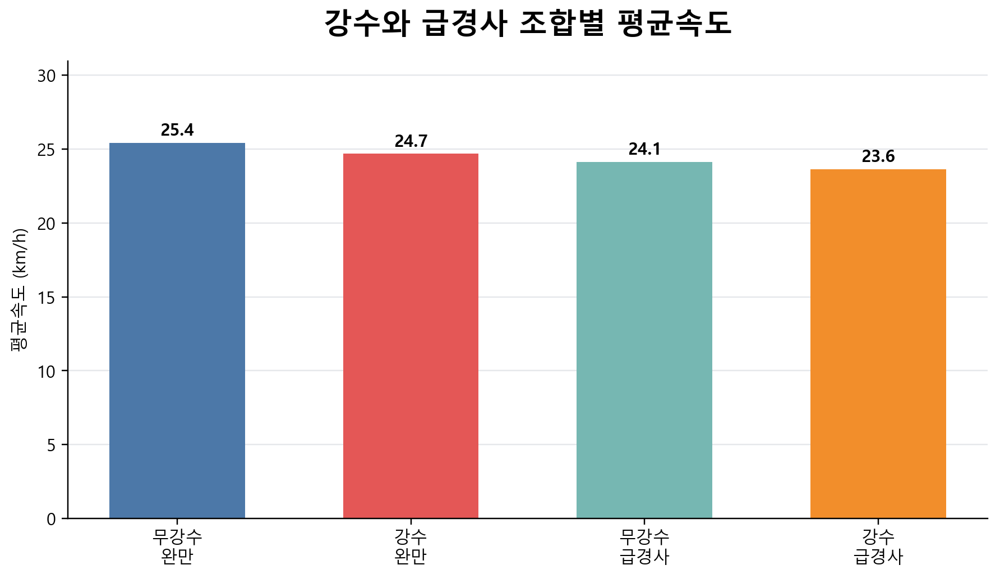
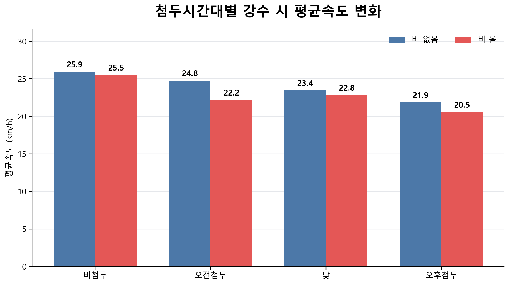
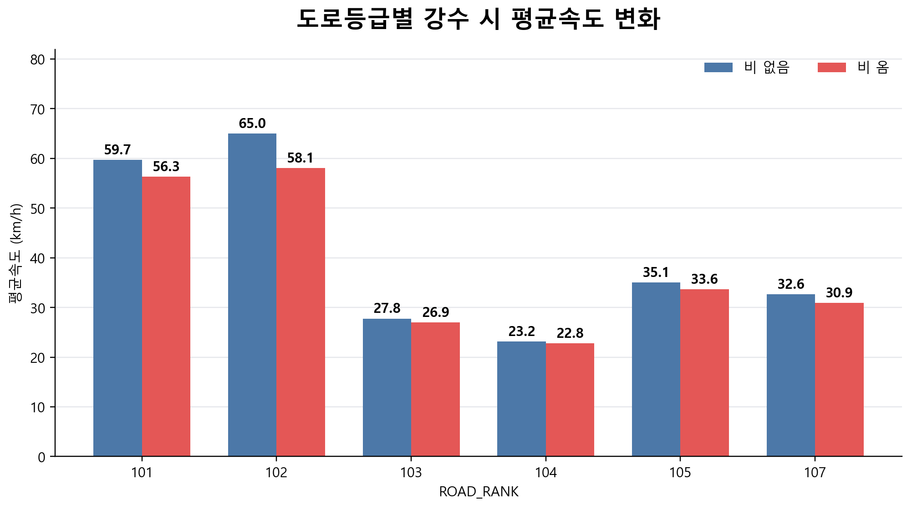

# Seoul Eco Routing

서울시 도로 링크, T-data 1시간 소통정보, DEM 고도, KMA 레이더 강수량을 결합해 링크별 속도·지형·기상 피처를 만드는 프로젝트입니다.

현재 속도 데이터는 T-data API가 아니라 T-data 사이트에서 내려받은 CSV를 사용합니다. KMA 레이더 강수량은 API로 내려받아 시간·공간 기준으로 링크에 매칭합니다.

## Project Structure

```text
.
├── src/
│   ├── 01_inspect_network_schema.py
│   ├── 02_extract_seoul_links.py
│   ├── 03_summarize_seoul_links.py
│   ├── 04_merge_tdata_link_speed.py
│   ├── 05_analyze_matched_links.py
│   ├── 06_plot_matched_links_map.py
│   ├── 07_add_dem_features.py
│   ├── 08_fetch_kma_radar.py
│   └── 09_add_radar_precip_features.py
├── notebooks/
│   └── 10_eda_report.ipynb
├── data/
│   ├── raw/
│   │   ├── road/       # MOCT_LINK.*, MOCT_NODE.*, MULTILINK.dbf, TURNINFO.dbf
│   │   ├── boundary/   # seoul_admin_boundary.geojson (서울 25개 자치구 경계)
│   │   ├── traffic/    # 1시간 소통정보 (구간별).csv
│   │   ├── dem/        # 37608.img, 37612.img, 37705.img, 37709.img
│   │   └── weather/    # KMA key, HSR grid, radar raw files
│   ├── interim/        # seoul_link.*
│   └── processed/      # generated CSV/GeoJSON/PNG/NPZ outputs
├── docs/
│   └── figures/
│       └── eda/       # 노트북이 생성하는 보고서용 EDA 그래프
└── README.md
```

`data/raw/`, `data/interim/`, `data/processed/`의 실제 데이터 파일은 대용량 원본/중간/가공 데이터이므로 Git에 올리지 않습니다. 대신 각 폴더에는 `.gitkeep`을 두어 필요한 폴더 구조만 GitHub에 표시합니다. 예외적으로 `data/raw/boundary/seoul_admin_boundary.geojson`은 크기가 작은 정적 참조 데이터라 커밋합니다(자세한 내용은 Notes 참고).

## Main Data

| Data | Path | Usage |
| --- | --- | --- |
| ITS 표준 링크 | `data/raw/road/MOCT_LINK.*` | 도로 링크 geometry와 속성 |
| ITS 표준 노드 | `data/raw/road/MOCT_NODE.*` | 도로망 노드 |
| 서울 행정경계 | `data/raw/boundary/seoul_admin_boundary.geojson` | 서울 링크 추출 기준 (25개 자치구 경계, EPSG:4326) |
| T-data 1시간 소통정보 | `data/raw/traffic/1시간 소통정보 (구간별).csv` | 링크별 시간대 평균속도 |
| DEM | `data/raw/dem/*.img` | 링크별 고도/경사도 |
| KMA HSR 격자 | `data/raw/weather/grid/hsr_lon.txt`, `hsr_lat.txt` | 레이더 격자 위치 |
| KMA 1시간 누적 강수 | `data/raw/weather/radar/hsr_pcph_acc60_*.txt` | 링크별 시간대 강수량 |

## Scripts

`src/`의 파일명 앞 번호는 실행 순서(파이프라인 순서)를 나타냅니다.

| Script | Description |
| --- | --- |
| `01_inspect_network_schema.py` | `MOCT_LINK.shp`의 크기, 컬럼, 좌표계 확인 |
| `02_extract_seoul_links.py` | 서울 행정경계(25개 자치구) 기준 링크를 추출해 `seoul_link.*`, `seoul_link_attr.csv` 생성 |
| `03_summarize_seoul_links.py` | 서울 링크 속성 기초 통계 출력 |
| `04_merge_tdata_link_speed.py` | `LINK_ID`와 `링크ID` 기준으로 T-data 속도 결합 |
| `05_analyze_matched_links.py` | T-data 매칭률, 도로등급별 커버리지, 연결 컴포넌트 분석 |
| `06_plot_matched_links_map.py` | 매칭 링크 지도 이미지와 GeoJSON 생성 |
| `07_add_dem_features.py` | DEM에서 링크별 고도/경사도 피처 생성 |
| `08_fetch_kma_radar.py` | KMA HSR 격자와 1시간 누적 레이더 강수량 다운로드 |
| `09_add_radar_precip_features.py` | 레이더 강수량을 링크·시간 기준으로 결합 |

이전에 있던 `create_matched_link_map.py`(외부 GIS 라이브러리 없이 SVG 지도를 그리는 대체 스크립트)는 `06_plot_matched_links_map.py`가 이미 GeoJSON과 지도 이미지를 만들고 있어 제거했습니다.

## Notebooks

| Notebook | Description |
| --- | --- |
| `10_eda_report.ipynb` | 최종 결합 테이블을 입력으로 강수량·경사도·도로등급·첨두시간대별 평균속도 EDA 테이블과 차트를 생성하는 리포트 |

이전에는 EDA 테이블 생성(`analyze_speed_feature_effects.py`), 표 이미지 렌더링(`plot_eda_tables.py`), 차트 이미지 렌더링(`plot_eda_charts.py`)이 스크립트 3개 + `data/processed/eda/` 아래 CSV 9개·차트 PNG 7개·표 PNG 7개로 흩어져 있었습니다. 이 셋은 결국 하나의 분석 리포트라서 노트북 하나로 통합했습니다. 집계 테이블은 노트북 셀 출력으로 바로 보이므로 CSV/표 이미지를 따로 저장하지 않고, 보고서용 차트 7장만 `docs/figures/eda/`에 저장합니다.

노트북을 다시 실행하려면:

```bat
jupyter lab notebooks\10_eda_report.ipynb
```

또는 커널 없이 일괄 실행 후 저장하려면:

```bat
python -m nbconvert --to notebook --execute --inplace notebooks\10_eda_report.ipynb
```

## Raw Schema

### MOCT_LINK

| Item | Value |
| --- | --- |
| Path | `data/raw/road/MOCT_LINK.shp` |
| Geometry | `LINESTRING` |
| Total links | `1,555,158` |
| CRS | `ITRF2000_Central_Belt_60` |
| Unit | metre |

주요 컬럼:

```text
LINK_ID, F_NODE, T_NODE, LANES, ROAD_RANK, ROAD_TYPE,
ROAD_NAME, MAX_SPD, LENGTH, geometry
```

### 서울 행정경계

| Item | Value |
| --- | --- |
| Path | `data/raw/boundary/seoul_admin_boundary.geojson` |
| Source | [southkorea/seoul-maps](https://github.com/southkorea/seoul-maps) (`juso/2015/json/seoul_municipalities_geo.json`) |
| Geometry | `Polygon` (자치구 25개) |
| CRS | `EPSG:4326` |

`02_extract_seoul_links.py`에서 25개 자치구 폴리곤을 하나로 합친 뒤 `MOCT_LINK`의 좌표계로 변환하고, `intersects`로 서울과 조금이라도 겹치는 링크를 추출합니다. `clip`을 쓰지 않는 이유는 경계선에 걸친 링크 geometry가 잘려 그래프 연결성이 오히려 나빠지기 때문입니다.

### T-data 1시간 소통정보

주요 컬럼:

```text
기준일, 시간코드, 시간대설명, 첨두시구분(T1/T2/T3:오전/낮/오후),
도로명, 도로방향구분코드, 도로방향구분명, 구간순서,
링크ID, 시작노드명, 종료노드명, 평균속도,
요일코드(1~7:일~토), 요일그룹코드(01:주중/02:주말),
도로코드, 도로구분코드, 도로구분명
```

### DEM

| Item | Value |
| --- | --- |
| Files | `37608.img`, `37612.img`, `37705.img`, `37709.img` |
| Format | HFA `.img` |
| CRS | `EPSG:5179` |
| Resolution | `90m x 90m` |
| Bands | 1 |
| dtype | `float32` |
| nodata | `-9999` |

도로 링크와 DEM의 좌표계가 다르므로 `07_add_dem_features.py`에서 링크를 `EPSG:5179`로 변환한 뒤 샘플링합니다.

### KMA HSR Radar

| Item | Value |
| --- | --- |
| API key file | `data/raw/weather/kma_api_key.txt` |
| Grid lon/lat API | `nph-rdr_latlon_api` |
| 1-hour accumulation API | `nph-rdr_cmp1_api` |
| Grid type | `cmp=HSR` |
| Precipitation product | `cmp=PCPH`, `qcd=MSK`, `obs=ECHO`, `acc=60`, `map=HB`, `disp=A` |
| Grid size | `2305 x 2881` |
| Raw radar file pattern | `data/raw/weather/radar/hsr_pcph_acc60_YYYYMMDDHHMM.txt` |

KMA ASCII 포맷에서 `-30000`은 레이더 관측영역 밖, `-25000`은 관측영역 안 무에코입니다. 강수 피처 생성 시 `-25000`은 `0mm`, `-30000` 이하는 결측으로 처리합니다.

## Generated Outputs

| File | Description |
| --- | --- |
| `data/interim/seoul_link.*` | 서울 행정경계 기준 링크 Shapefile |
| `data/processed/seoul_link_attr.csv` | 서울 링크 속성 테이블 |
| `data/processed/seoul_link_speed_merged.csv` | T-data 속도 + 서울 링크 속성 |
| `data/processed/seoul_link_dem_features.csv` | 링크별 DEM 고도/경사도 피처 |
| `data/processed/seoul_link_speed_dem_merged.csv` | 속도 + 링크 속성 + DEM |
| `data/processed/weather_hsr_seoul_grid.npz` | 서울 bbox 주변 HSR 격자 캐시 |
| `data/processed/link_radar_grid_mapping.csv` | 링크 중심점과 가장 가까운 HSR 격자 매핑 |
| `data/processed/seoul_link_radar_precip.csv` | 링크별 시간대 레이더 강수 피처 |
| `data/processed/seoul_link_speed_dem_weather_merged.csv` | 최종 속도 + 링크 + DEM + 강수 결합 테이블 |
| `data/processed/matched_road_rank_coverage.csv` | 도로등급별 T-data 매칭률 |
| `data/processed/matched_graph_components.csv` | 매칭 링크 연결 컴포넌트 |
| `data/processed/matched_link_ids.csv` | T-data와 매칭된 링크 목록 |
| `data/processed/matched_links.geojson` | 매칭 링크 GeoJSON |
| `data/processed/matched_links_map.png` | 매칭 링크 분포 지도 |
| `docs/figures/eda/*.png` | `10_eda_report.ipynb`가 생성하는 GitHub/보고서용 EDA 그래프 이미지 |

## Current Results

`02_extract_seoul_links.py`가 bbox 대신 서울 행정경계(25개 자치구)로 링크를 추출하도록 바뀌면서, 아래 수치는 이전 bbox 기준 결과(서울 링크 109,633개)보다 전반적으로 낮아졌습니다. bbox가 실제 서울보다 넓은 사각형이라 경기/인천 일부 링크를 서울로 잘못 세고 있었기 때문입니다.

### T-data Matching

```text
서울 링크 수: 63,548
T-data 행 수: 608,538
결합된 T-data 행 수: 180,488
결합된 고유 링크ID 수: 1,517
```

T-data 매칭 링크만으로 만든 그래프의 연결성은 낮습니다.

```text
연결 컴포넌트 수: 1,365
최대 컴포넌트 링크 수: 17
최대 컴포넌트 링크 비율: 1.12%
```

따라서 현재 데이터만으로는 서울 전체 OD 경로탐색보다, T-data 속도 이력이 확보된 주요 링크의 속도/에너지 비효율 구간 분석이 더 안전합니다.

### DEM

```text
서울 링크 수: 63,548
DEM 샘플 존재 링크 비율: 100.0%
대부분 링크의 dem_sample_count: 5
```

### Radar Precipitation

```text
T-data 대상 레이더 시각 수: 119
다운로드 완료 레이더 시각 수: 119
누락 레이더 시각 수: 0
최종 결합 행 수: 180,488
강수값 존재 행 수: 180,488
```

강수량 요약:

```text
mean precip_mm: 5.90
median precip_mm: 0.00
max precip_mm: 47.57
precip_mm > 0 행 수: 50,077
precip_mm > 0 시각 수: 53
```

### Speed Feature EDA

최종 결합 테이블(`seoul_link_speed_dem_weather_merged.csv`)을 입력으로 `10_eda_report.ipynb`에서 강수량, 경사도, 도로등급, 첨두시간대에 따른 평균속도 차이를 1차 탐색했습니다.

주요 결과:

```text
무강수 평균속도: 25.29 km/h
강수 평균속도: 24.58 km/h
무강수 + 완만 구간 평균속도: 25.41 km/h
강수 + 급경사 구간 평균속도: 23.65 km/h
오전첨두 무강수 평균속도: 24.77 km/h
오전첨두 강수 평균속도: 22.19 km/h
```

보고서용 그래프는 노트북 실행 시 아래 위치에 생성됩니다.

```text
docs/figures/eda/
├── 01_rain_flag_speed.png
├── 02_rain_intensity_speed.png
├── 03_slope_bin_speed.png
├── 04_rain_slope_combo_speed.png
├── 05_peak_rain_speed.png
├── 06_road_rank_rain_speed.png
└── 07_feature_correlation_speed.png
```

대표 그래프:







이 결과는 인과관계 검증이 아니라 탐색적 분석입니다. 최종 해석에서는 시간대, 도로등급, 제한속도, 링크별 특성을 함께 통제해야 합니다.

## Workflow

```bat
.venv\Scripts\activate.bat

python src\01_inspect_network_schema.py
python src\02_extract_seoul_links.py
python src\03_summarize_seoul_links.py
python src\04_merge_tdata_link_speed.py
python src\05_analyze_matched_links.py
python src\06_plot_matched_links_map.py
python src\07_add_dem_features.py
python src\08_fetch_kma_radar.py --grid
python src\08_fetch_kma_radar.py --from-tdata-times
python src\09_add_radar_precip_features.py

python -m nbconvert --to notebook --execute --inplace notebooks\10_eda_report.ipynb
```

가상환경을 활성화하지 않고 실행할 때:

```bat
.venv\Scripts\python.exe src\09_add_radar_precip_features.py
```

KMA 레이더 한 시각만 받을 때:

```bat
python src\08_fetch_kma_radar.py --tm 202607070300
```

## Notes

- `02_extract_seoul_links.py`는 `data/raw/boundary/seoul_admin_boundary.geojson`(서울 25개 자치구 경계, EPSG:4326)을 하나로 합쳐 `intersects`로 링크를 추출합니다. `clip`을 쓰지 않는 이유는 경계선에 걸친 링크의 geometry가 잘려 그래프 연결성이 나빠질 수 있기 때문입니다.
- 경계 GeoJSON은 [southkorea/seoul-maps](https://github.com/southkorea/seoul-maps) 저장소의 2015년 자치구 경계를 받아 사용합니다. 다른 raw 데이터와 달리 크기가 작고(1.6MB) 정적인 참조 데이터라 `data/raw/boundary/seoul_admin_boundary.geojson`은 예외적으로 Git에 커밋합니다. 다만 출처 저장소에 명시적 라이선스가 없어(`LICENSE` 파일 없음), 이 저장소가 public으로 전환되기 전에 공공누리(KOGL) 라이선스가 명시된 공식 출처(SGIS, VWorld, 국가공간정보포털 등)로 교체하는 것을 권장합니다.
- T-data API 수집 코드는 사용하지 않습니다.
- `data/raw/` 아래 원본 데이터는 직접 받은 파일이므로 코드에서 수정하지 않는 것을 원칙으로 합니다.
- DEM은 90m 해상도이므로 짧은 링크에서는 경사도 값이 튈 수 있습니다. 모델링 전 `LENGTH` 기준 필터링이나 경사도 이상치 처리가 필요합니다.
- KMA 레이더 원본은 한 시각당 약 48MB이며, 현재 T-data 대상 119개 시각 원본은 약 5.7GB입니다.
