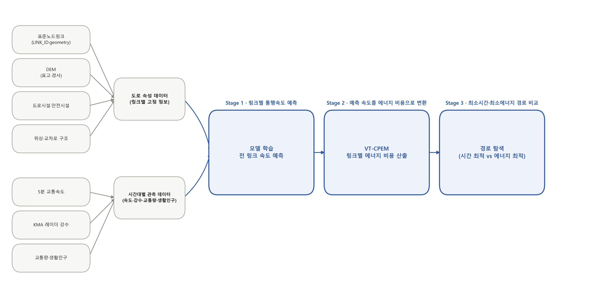
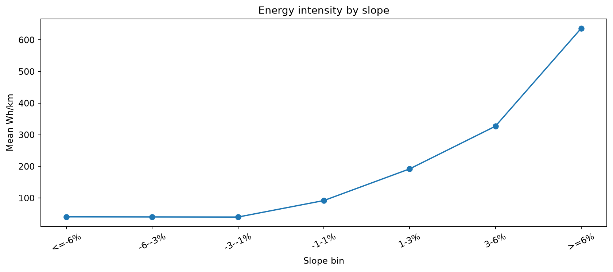

<div align="center">

# 에코 라우팅을 위한<br>서울시 도로 에너지 비효율 구간 진단

**팀 고유가지원금**<br>
<sub>🏆 <a href="https://www.mju.ac.kr/innovation/1090/subview.do?enc=Zm5jdDF8QEB8JTJGYmJzJTJGaW5ub3ZhdGlvbiUyRjU2JTJGMjMzMDE0JTJGYXJ0Y2xWaWV3LmRvJTNG">명지대학교 2026학년도 제5회 창의적 SW프로그램 경진대회</a> · 빅데이터 분석 부문 장려상</sub>


**[📄 데이터 분석 보고서 (발표본 PDF)](데이터분석보고서.pdf)** &nbsp;·&nbsp; [보고서 본문](docs/DATA_ANALYSIS_REPORT.md) &nbsp;·&nbsp; [실행 방법](#quickstart) &nbsp;·&nbsp; [데이터 사전](data/README.md)

</div>

---

내비게이션은 보통 가장 빠른 길을 추천한다. 그러나 전기차의 배터리 소비는 거리만으로 정해지지 않는다. 오르막이 이어지거나 정체로 저속 주행이 길어지면 같은 거리라도 훨씬 많은 에너지를 쓴다. 이 프로젝트는 서울 표준노드링크 **63,548개 전체 도로**에 시간대별 속도와 전기차 에너지 비용을 채우고, **가장 빠른 길과 가장 에너지를 적게 쓰는 길이 실제로 얼마나 다른지** 비교한다.

> [!IMPORTANT]
> **빠른 길이 곧 효율적인 길은 아니다.** 최단시간 경로 대신 최소에너지 경로를 고르면 평균 12.4%의 에너지가 줄지만 시간이 20.3% 늘어난다. 지연을 15% 안으로 묶은 균형 경로는 시간을 8.2%만 더 쓰고 에너지를 8.3% 줄인다.

<table>
<tr>
<td align="center" width="25%"><b>분석 규모</b><h3>63,548 링크</h3>서울 전 도로망 × 335시점<br>(2026-07-07~07-20)<br><sub>링크-시간 21,288,580개</sub></td>
<td align="center" width="25%"><b>속도 공백</b><h3>29.25%</h3>5분 속도가 관측되지 않는<br>도로(대부분 이면도로)<br><sub>AI 모델로 결측 없이 채움</sub></td>
<td align="center" width="25%"><b>최소에너지 경로</b><h3>−12.4%</h3>최단시간 대비 에너지<br>(시간 +20.3%)<br><sub>대표 30개 OD 평균</sub></td>
<td align="center" width="25%"><b>균형 경로</b><h3>−8.3%</h3>15% 지연 상한 안에서<br>에너지 최소화(시간 +8.2%)<br><sub>Pareto label-setting</sub></td>
</tr>
</table>



## 데이터

8개 기관·플랫폼의 공공데이터 13종(원자료 약 110GB)을 링크 단위로 결합해, 정적 속성 표와 시간별 관측 속도 표(약 1.1GB)로 압축했다. 자료별 컬럼·행 수·용도는 [데이터 사전](data/README.md)에 있다.

| 묶음 | 데이터 | 쓰임 |
| --- | --- | --- |
| 도로망 | 전국표준노드링크, 서울 행정경계 | 분석 대상 링크 63,548개, 이웃 관계 |
| 속도 | 5분 단위 통행속도(93GB), View-T 평균속도·혼잡강도, 교통량 | 학습 목표, 시간대 교통 프로필 |
| 지형·기상 | 수치표고모델(DEM), 기상청 레이더 강수 | 방향성 경사, 시간대별 강수 |
| 도로 환경 | 버스전용차로, 어린이보호구역, 과속방지턱, 사고다발지역, 생활인구 | 속도 모델 변수 |

## 분석 방법

| 단계 | 내용 |
| --- | --- |
| **① 속도 예측** | 속도 이력이 있는 링크는 이력 조회표(**Model A**), 없는 링크는 이웃 도로 관측 여부에 따라 XGBoost(**Model B·C**)로 예측해 전 링크의 시간대별 속도를 결측 없이 완성 |
| **② 에너지 변환** | 예측 속도와 링크 길이·경사를 **VT-CPEM**(전력 기반 전기차 에너지 모델, Nissan Leaf 기준)에 넣어 링크별 배터리 소비 에너지 계산 |
| **③ 경로 비교** | **Dijkstra**로 최단시간·최소에너지 경로를, **Pareto label-setting**으로 지연 상한 안의 균형 경로를 탐색해 비교 |

Model A·B·C는 도로의 품질 등급이 아니라 그 링크에서 확보할 수 있는 속도 정보의 수준이다(구분은 [분석 문서 안내](docs/README.md) 참고).

| 모델 | 대상 | 검증 |
| --- | --- | --- |
| **A · 이력 조회표** | 속도 관측이 있는 44,960개 링크 | 시간 순 분할(과거 11일 → 미래 3일): R² 0.92, MAE 2.3km/h |
| **B · XGBoost** | 1~2홉 이웃에 관측 도로가 있는 16,752개 링크 | 학습에 쓰지 않은 도로로 평가(링크 단위 3-fold GroupKFold): R² 0.72 |
| **C · XGBoost** | 이웃 관측도 없는 1,836개 링크 | 같은 방식, R² 0.31 |

SHAP 기준으로 속도 예측에 가장 크게 기여한 변수는 이웃 도로 속도(35.6%)다.

## 결과

### 경사가 에너지를 가른다

관측 속도를 에너지식에 넣으면 평지(−1~1%)에서 약 93Wh/km이던 소비가 6% 이상 오르막에서 약 627Wh/km로 늘어난다. 저속에서는 통과 시간이 길어 보조전력 비중이, 고속에서는 공기저항이 커지므로, 느린 길이나 짧은 길이 곧 에너지 최소 경로는 아니다.



### 시간을 조금 양보하면 에너지가 준다

2026-07-16 08:00 스냅샷, 서울 주요 지점 간 대표 30개 OD 기준이다.

| 경로 | 평균 에너지 절감 | 평균 시간 증가 |
| --- | ---: | ---: |
| 무제약 최소에너지 | **12.4%** | 20.3% |
| 15% 지연 상한 균형 경로 | **8.3%** | 8.2% |

FastAPI 대시보드(`app/`)에서 출발지·목적지를 골라 세 경로를 지도에서 직접 비교할 수 있다. 같은 경사 대비 에너지가 비정상적으로 큰 구간을 골라 에너지 비효율 도로를 진단하는 데도 쓴다.

## 한계

- 분석 기간이 여름 14일이라 계절성, 겨울철 난방 부하, 휴일 효과를 대표하지 못한다.
- B·C의 검증은 관측 링크를 가상으로 가린 대리 검증이며, 실제 미관측 링크의 정답은 없다.
- 에너지식은 링크 안 정속·가속도 0·회생제동 없음·고정 보조전력을 가정하고, 실차 전력으로 보정하지 않았다.
- 라우팅은 한 시각의 정적 스냅샷 기준이며 신호 대기·회전 비용·실시간 교통은 반영하지 않는다. 실서비스 내비게이션이 아닌 연구용 비교 프로토타입이다.

전체 한계와 후속 과제는 [보고서 본문 7장](docs/DATA_ANALYSIS_REPORT.md#7-한계)에 있다.

## 저장소 구조

```text
seoul-eco-routing/
├── app/
│   ├── server.py      FastAPI 대시보드 백엔드(uvicorn app.server:app)
│   └── static/        Vanilla JS·HTML·CSS 프론트엔드(Leaflet)
├── src/
│   ├── pipeline/      01~05 원자료 정제 — 링크 추출, 5분 속도 집계, 레이더 강수, 차원·팩트 표
│   ├── models/        01~04 Model A 조회표, B·C XGBoost 학습·검증, 전 링크 속도 예측
│   ├── energy/        01~03 VT-CPEM 링크 에너지 계산
│   ├── routing/       engine.py(Dijkstra·Pareto), 단일 OD 비교, 다중 OD 시나리오
│   └── eda/           01~05 관측·예측 EDA, 하이브리드 에너지 표 구축(그림 39개)
├── notebooks/         01~04 속도 모델 선택 과정의 실험 기록
├── docs/              보고서 본문, 방법론, EDA·대시보드 가이드, figures/
├── tests/             에너지식·라우팅 엔진 단위 테스트
└── data/              데이터 사전(원자료·산출물은 저장소에 포함하지 않음)
```

<a id="quickstart"></a>

## 실행 방법

Windows, Python 3.13에서 실행했다. 원자료와 대부분의 산출물은 `.gitignore`로 제외되어 있어, 새로 clone한 상태에서는 아래 순서를 처음부터 실행해야 라우팅과 대시보드가 동작한다. 저장소에 포함된 것은 학습된 B·C 모델(`src/models/artifacts/`)과 조회표 2종(`data/processed/`)뿐이다.

> [!NOTE]
> 단계 순서를 바꾸면 안 된다. 라우팅과 대시보드는 4단계가 만드는 `historical_hybrid_link_energy/`를 읽는다. `data/`를 통째로 받은 경우에는 5·6단계로 바로 넘어가도 된다.

<details>
<summary><b>1단계 · 원자료 가공</b></summary>

```powershell
python src/pipeline/01_extract_seoul_links.py
python src/pipeline/02_aggregate_5min_speed.py
python src/pipeline/03_fetch_kma_radar.py --from-5min-times
python src/pipeline/04_build_link_dimension.py
python src/pipeline/05_build_speed_fact.py
```

5분 원본은 하루치가 약 7GB(전국)라 `data/raw/traffic/202607_5Min/`에는 보통 최근 날짜만 둔다. `02`는 기존 집계를 읽어 폴더에 없는 과거 날짜는 보존하고 폴더에 있는 날짜만 새로 반영한다.

</details>

<details>
<summary><b>2단계 · 속도 모델(A 조회표 + B·C XGBoost)</b></summary>

```powershell
python src/models/01_build_model_a.py
python src/models/02_build_model_bc.py --mode validate
python src/models/02_build_model_bc.py --mode final
python src/models/04_batch_predict_all_link_speed.py --start-date 20260707 --end-date 20260720
```

</details>

<details>
<summary><b>3단계 · 전기차 에너지(VT-CPEM)</b></summary>

```powershell
python src/energy/02_batch_compute_link_energy.py --start-date 20260707 --end-date 20260720
python src/energy/03_compute_observed_speed_energy.py --start-date 20260707 --end-date 20260720 --exclude-tm 202607070000
```

</details>

<details>
<summary><b>4단계 · EDA와 하이브리드 에너지 표</b></summary>

```powershell
python src/eda/01_observed_speed_eda.py
python src/eda/02_observed_energy_eda.py
python src/eda/03_compare_observed_lookup_and_build_hybrid.py   # historical_hybrid_link_energy/ 생성
python src/eda/04_speed_energy_eda.py --start-date 20260707 --end-date 20260720
```

</details>

<details>
<summary><b>5단계 · 라우팅(Dijkstra + Pareto 균형 경로)</b></summary>

```powershell
python src/routing/02_evaluate_route_scenarios.py --timestamps 202607160800 --max-pairs 30
```

</details>

<details>
<summary><b>6단계 · 대시보드</b></summary>

`data/interim/seoul_link.shp`(1단계)와 `historical_hybrid_link_energy/`(4단계)가 있어야 뜬다.

```powershell
pip install -r requirements-dashboard.txt
uvicorn app.server:app --reload
# http://127.0.0.1:8000
```

</details>

각 단계의 입력·출력·설계 근거는 [방법론과 코드 파이프라인](docs/METHODS_AND_PIPELINE.md)에 있다.

## 문서 안내

| 문서 | 내용 |
| --- | --- |
| [데이터 분석 보고서](docs/DATA_ANALYSIS_REPORT.md) | 발표본 PDF를 서술형으로 정리한 본문 — 배경·데이터·방법·결과·한계·결론 |
| [방법론과 코드 파이프라인](docs/METHODS_AND_PIPELINE.md) | 공식 스크립트의 입력·처리·출력·실행 순서, 피처 구성, 에너지식, 라우팅 |
| [분석 문서 안내](docs/README.md) | 문서 읽는 순서, A 관측값·A 조회표·B·C 예측·에너지 추정치의 구분 |
| [EDA 그림·표 해석](docs/EDA_GUIDE.md) | 그림 39개 각각의 축·의미·주의점 |
| [노트북 전수 검토](docs/NOTEBOOK_AUDIT.md) | `notebooks/01~04` 인용 방법과 현재 코드와의 차이 |
| [대시보드 가이드](docs/DASHBOARD_GUIDE.md) | 에코 라우팅 대시보드 실행과 API |
| [데이터 사전](data/README.md) | 폴더·파일·컬럼·행 수·용도 |

---

<div align="center">
<sub>고유가지원금 · 2026</sub>
</div>
