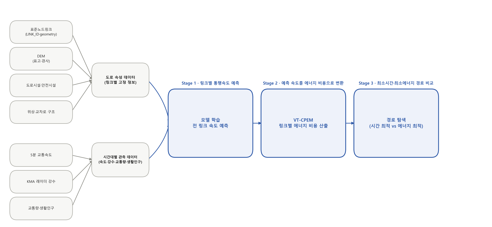

# Seoul Eco Routing

서울시 도로망 전체를 대상으로 전기차 에너지 소비를 예측하고, 가장 에너지 효율적인 경로를 실제로 찾아내는 에코 라우팅 프로젝트입니다.

## 개요

내비게이션은 보통 최단 거리나 최단 시간을 기준으로 경로를 추천합니다. 그러나 실제 에너지 소비는 이동 거리만으로 결정되지 않습니다. 오르막이 이어지는 구간, 정체로 저속 주행이 길어지는 구간은 같은 거리라도 훨씬 많은 에너지를 씁니다. 전기차는 속도·가속도·도로 경사만으로 배터리 소비 전력을 물리식(VT-CPEM)으로 비교적 정확히 계산할 수 있어, 이 에너지를 경로 탐색의 정량적 기준으로 바로 쓸 수 있습니다.

이 프로젝트는 서울시 표준노드링크 63,548개 전체 도로망에 대해 시간대별 통행속도와 전기차(Nissan Leaf 기준) 에너지 비용을 실제로 구축하고, 이를 근거로 최단시간 경로와 최소에너지 경로가 실제로 얼마나 다른지 비교합니다. 가장 먼저 부딪히는 난관은 속도 데이터 자체입니다 — 서울 전체 도로의 70.75%(44,960개)만 5분 단위로 직접 관측되고, 나머지 29.25%는 관측 인프라가 없는 이면도로라 속도가 아예 존재하지 않습니다. 이 공백을 채우는 것부터 시작해, 문제 전체를 3단계로 접근합니다.



| Stage | 내용 |
| --- | --- |
| 1. 속도 예측 | 실측 속도가 있는 링크는 이력 조회표(Model A), 나머지는 이웃 도로 관측 여부에 따라 XGBoost(Model B/C)로 예측해 63,548개 전 링크의 시간대별 속도를 결측 없이 완성 |
| 2. 에너지 변환 | 예측 속도와 링크 길이·경사를 VT-CPEM(전력 기반 전기차 에너지 소비 모델) 물리식에 입력해 링크별 배터리 소비 에너지를 계산 |
| 3. 경로 비교 | Dijkstra로 최단시간·최소에너지 경로를 탐색하고, Pareto label-setting 알고리즘으로 지연 상한 안에서 에너지를 최소화하는 균형 경로도 함께 비교 |

Model A/B/C는 도로의 품질 등급이 아니라, 그 링크에 대해 확보할 수 있는 속도 정보의 수준을 뜻합니다(자세한 값 구분은 [분석 문서 안내](docs/README.md) 참고).

## 핵심 결과

서울 주요 지점 간 대표 30개 OD 비교 기준입니다.

| 지표 | 값 |
| --- | --- |
| 분석 규모 | 63,548개 링크 × 335시점(14일, 2026-07-07~07-20) |
| 무제약 최소에너지 경로 | 최단시간 대비 평균 **12.4%** 에너지 절감(시간 +20.3%) |
| 15% 지연 상한 균형경로 | 평균 **8.3%** 에너지 절감(시간 +8.2%로 억제) |
| 속도 예측 모델 해석 | SHAP 기준 이웃 도로 속도가 가장 큰 기여 요인(35.6%) |

FastAPI 기반 대시보드(`app/`)에서 출발지·목적지를 입력해 세 경로를 직접 비교해 볼 수 있습니다. 연구 배경·데이터·방법론·전체 결과·한계는 **[데이터 분석 보고서](docs/DATA_ANALYSIS_REPORT.md)**에 정리되어 있습니다.

## Quickstart

원자료부터 전부 다시 만든다는 전제의 순서입니다. 대시보드와 라우팅은 각각 필요한 산출물이 먼저 만들어져 있어야 하므로, 아래 순서를 바꾸면 안 됩니다.

```powershell
# 1. 원자료 가공
python src/pipeline/01_extract_seoul_links.py
python src/pipeline/02_aggregate_5min_speed.py
python src/pipeline/03_fetch_kma_radar.py --from-5min-times
python src/pipeline/04_build_link_dimension.py
python src/pipeline/05_build_speed_fact.py

# 2. 속도 모델(A lookup + B/C XGBoost)
python src/models/01_build_model_a.py
python src/models/02_build_model_bc.py --mode validate
python src/models/02_build_model_bc.py --mode final
python src/models/04_batch_predict_all_link_speed.py --start-date 20260707 --end-date 20260720

# 3. 전기차 에너지(VT-CPEM)
python src/energy/02_batch_compute_link_energy.py --start-date 20260707 --end-date 20260720
python src/energy/03_compute_observed_speed_energy.py --start-date 20260707 --end-date 20260720 --exclude-tm 202607070000

# 4. EDA(관측/예측/하이브리드, 총 39개 그림) — 03이 라우팅·대시보드가 읽는 historical_hybrid_link_energy/를 생성
python src/eda/01_observed_speed_eda.py
python src/eda/02_observed_energy_eda.py
python src/eda/03_compare_observed_lookup_and_build_hybrid.py
python src/eda/04_speed_energy_eda.py --start-date 20260707 --end-date 20260720

# 5. 라우팅(Dijkstra + Pareto 균형경로) — 4번 산출물이 있어야 실행 가능(기본값이 historical_hybrid_link_energy/를 읽음)
python src/routing/02_evaluate_route_scenarios.py --timestamps 202607160800 --max-pairs 30

# 6. 대시보드 — data/interim/seoul_link.shp(1번)와 historical_hybrid_link_energy/(4번)가 있어야 뜸
pip install -r requirements-dashboard.txt
uvicorn app.server:app --reload
# http://127.0.0.1:8000
```

`data/`를 통째로 전달받는 등 산출물이 이미 있는 경우에는 앞 단계를 재실행할 필요 없이 6번(대시보드)이나 5번(라우팅)으로 바로 건너뛸 수 있습니다. 다만 이 저장소를 새로 clone한 상태에서는 `.gitignore`로 대부분의 `data/` 산출물이 제외되어 있어(예외는 `src/models/artifacts/`의 학습된 모델 2종과 `data/processed/`의 조회표 2종뿐) 위 순서를 처음부터 실행해야만 라우팅과 대시보드가 동작합니다. 각 단계의 입력·출력·설계 근거는 **[방법론과 코드 파이프라인](docs/METHODS_AND_PIPELINE.md)**을 참고하세요.

## Project Structure

```text
.
├── app/
│   ├── server.py   # FastAPI 기반 에코 라우팅 대시보드 백엔드(uvicorn app.server:app)
│   └── static/     # Vanilla JS/HTML/CSS 프론트엔드
├── src/
│   ├── pipeline/   # 01~05: 원자료 수집·정제(ETL) — 링크 추출, 속도 집계, 강수, 차원/팩트 테이블
│   ├── models/     # 01~04: A lookup, B/C XGBoost 학습·검증, 전 링크 속도 예측
│   ├── energy/     # 01~03: VT-CPEM 링크 에너지 계산
│   ├── routing/    # engine.py(Dijkstra), 01(단일 OD), 02(다중 OD 시나리오), build_all_link_weather_snapshot.py(강수 스냅샷 보조)
│   └── eda/        # 01~05: 관측/예측 EDA·하이브리드 구축(39개 그림)
├── notebooks/      # 01~04: 모델 선택 과정의 연구 기록(현재 배포 코드는 src/models)
├── data/
│   ├── README.md   # 데이터 사전 — 폴더·파일·컬럼·행 수·용도
│   ├── raw/        # 원본(도로망, 5분 교통속도, DEM, 레이더, 교통량·생활인구 등)
│   ├── interim/    # 파이프라인 중간 산출물
│   └── processed/  # 차원/팩트 테이블, 모델 아티팩트, 전 링크 속도·에너지 산출물
├── docs/
│   └── figures/    # observed_speed_eda/, observed_speed_energy_eda/, observed_vs_lookup/, speed_energy_eda/, model/, model_a/, network/
└── tests/          # 에너지식 단위 테스트
```

`data/raw/`, `data/interim/`, `data/processed/`의 실제 데이터 파일은 대용량 원본/중간/가공 데이터이므로 Git에 올리지 않습니다(`.gitkeep`으로 폴더 구조만 유지).

## 문서

- **[데이터 분석 보고서](docs/DATA_ANALYSIS_REPORT.md)** — 연구 배경·데이터·방법론·결과·한계·결론(보고서 본문)
- **[방법론과 코드 파이프라인](docs/METHODS_AND_PIPELINE.md)** — 모든 공식 스크립트의 입력·처리·출력·설계 근거·실행 순서, 피처 구성, 에너지식, 라우팅
- **[노트북 전수 검토](docs/NOTEBOOK_AUDIT.md)** — `notebooks/01~04`를 보고서에서 어떻게 인용해야 하는지, 현재 코드와의 차이
- **[EDA 그림·표 해석](docs/EDA_GUIDE.md)** — 39개 그림 각각의 축·의미·주의점
- **[대시보드 가이드](docs/DASHBOARD_GUIDE.md)** — 에코 라우팅 대시보드 실행·API
- **[데이터 사전](data/README.md)** — 폴더·파일·컬럼·행 수·용도, 과거 파일과 현재 사용 여부
- **[분석 문서 안내](docs/README.md)** — 문서를 읽는 순서, A-Observed/A lookup/B·C prediction/에너지 추정치의 정확한 구분
- **[서울 전 도로망 실루엣](docs/figures/network/01_seoul_all_links_silhouette.png)** — 기본 지도

## Notes

- `data/raw/` 아래 원본 데이터는 직접 받은 파일이므로 코드에서 수정하지 않는 것이 원칙입니다.
- 5분 단위 원본은 하루치가 약 7GB(전국 단위)라 `data/raw/traffic/202607_5Min/`에는 보통 최근 받은 날짜만 남아있습니다. `src/pipeline/02_aggregate_5min_speed.py`는 실행할 때마다 기존 집계 결과를 읽어 폴더에 없는 과거 날짜는 보존하고 폴더에 있는 날짜만 새로 반영합니다 — 새 날짜를 추가하려면 그 날짜 파일만 폴더에 넣고 02번을 다시 실행하면 됩니다.
