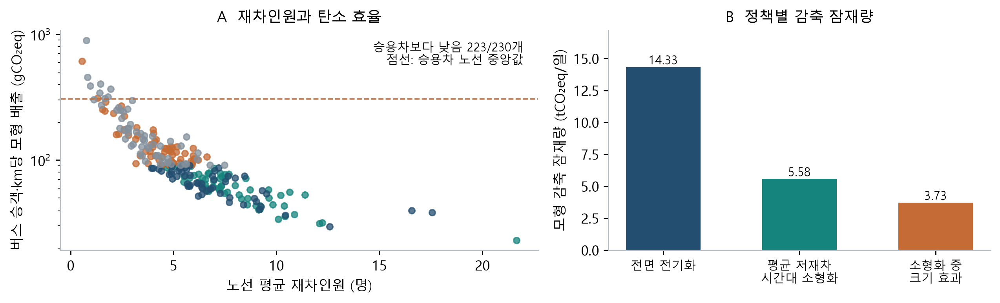
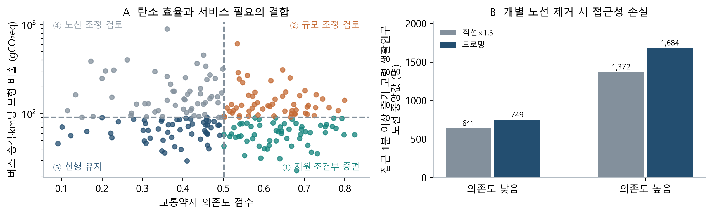
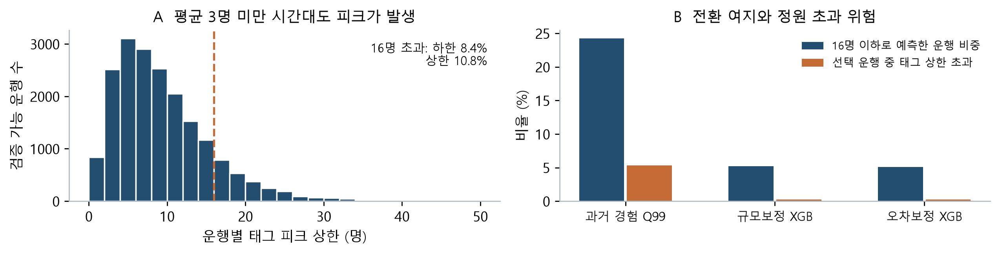

# 서울 마을버스의 탄소 효율과 고령자 이동권을
고려한 차량 및 운행 정책 분석

전예준·김명관 | 덜컹덜컹달려간다마을버스야 | 2026.10.14

## 1. 주제 및 2. 분석 배경·목적

마을버스는 언덕·골목의 주거지를 지하철·일반버스·생활시설에 연결한다. 본 분석 230개 노선의 하루 승차는 약 90만 건으로 서로 다른 이용자 수와는 다르다. 짧은 이동과 낮은 이용량만으로 사회적 가치를 판단하기 어렵다. 보행이 어렵거나 대체수단이 부족한 주민에게는 이 구간이 전체 이동의 가능성을 결정한다. 한편 적은 승객을 위해 큰 차량을 반복 운행하면 탄소 효율이 낮아질 수 있다. **필요한 서비스를 유지하면서 친환경 전환을 어떻게 설계할 것인가**가 본 연구의 출발점이다.

서울시는 2025년 12월 서비스 개선 합의에서 2026년 마을버스 재정지원 412억→500억원, 전체 운행 약 5% 확대를 발표했다[1]. 이는 추진 계획이며 실제 달성률을 검증한 결과는 아니다. 서비스 확충과 친환경 전환을 연결하려면 연료뿐 아니라 노선의 수송 효율·이동권 가치·차량 용량을 함께 판단해야 한다. 고령자 교통카드 이용 및 저상버스 배치 연구[2,3]도 이용 특성과 접근 조건의 중요성을 다룬다.

본 연구는 ① 같은 운행 조건에서 버스·승용차의 승객당 탄소를 비교하고, ② 고령자 의존도와 노선 제거의 접근성 손실을 평가하며, ③ 전기화·소형화·지원·조건부 증편 후보를 도출하고, ④ 운행별 피크 예측과 차량 배치로 후보의 실행 조건을 검증한다. 참여 목적은 **탄소중립과 이동의 형평성을 같은 판단 체계에 연결**하는 것이다.

## 3. 활용 데이터

| 활용 데이터·선정 이유 | 제공기관 / 플랫폼 | 출처 URL |
| --- | --- | --- |
| 표준노드링크·5분 속도: 방향성 도로망과 속도 관측 | 국토교통부 / ITS | [its.go.kr/nodelink](https://www.its.go.kr/nodelink/nodelinkStatus?service=inquiryNodelink); [opendata](https://www.its.go.kr/opendata/) |
| HSR 강수·DEM: 속도 환경과 방향성 경사 | 기상청·국토지리정보원 / API허브·국토정보 | [apihub.kma.go.kr](https://apihub.kma.go.kr/apiList.do?seqApi=5); [map.ngii.go.kr](https://map.ngii.go.kr/) |
| AADT·혼잡, 전용차로·보호구역·험프·사고: 속도 변수 | 교통연구원·서울시·도로교통공단 / View-T·열린데이터·TAAS | [View-T](https://viewt.ktdb.go.kr/cong/map/second_map.do); [OA-22396](https://data.seoul.go.kr/dataList/OA-22396/F/1/datasetView.do); [2799](https://data.seoul.go.kr/dataList/OA-2799/F/1/datasetView.do); [15541](https://data.seoul.go.kr/dataList/OA-15541/A/1/datasetView.do); [TAAS](https://opendata.koroad.or.kr/api/selectPedstriansDataSet.do) |
| 노선 경로·정류소: 실제 거리·순서·도로 매칭 | 서울시 / 버스 API·열린데이터 | [getRoutePath](http://ws.bus.go.kr/api/rest/busRouteInfo/getRoutePath); [OA-1095](https://data.seoul.go.kr/dataList/OA-1095/L/1/datasetView.do) |
| 시간대 승하차·정류장 운행횟수: 승객·km·평균 재차 | 서울시·TOPIS / 열린데이터 | [OA-12913](https://data.seoul.go.kr/dataList/OA-12913/F/1/datasetView.do); [OA-21220](https://data.seoul.go.kr/dataList/OA-21220/S/1/datasetView.do) |
| 교통카드 이용·노선·정류장: 개별 운행 피크 검증 | 서울시 / T-DATA | [t-data.seoul.go.kr / 20006](https://t-data.seoul.go.kr/dataprovide/trafficdataviewfile.do?data_id=20006) |
| 생활인구·역사마스터·차량 등록: 의존도·대체수단·연료 구성 | 서울시·KT / 열린데이터 | [생활인구](https://data.seoul.go.kr/dataVisual/seoul/seoulLivingPopulation.do); [OA-21232](https://data.seoul.go.kr/dataList/OA-21232/S/1/datasetView.do); [15640](https://data.seoul.go.kr/dataList/OA-15640/F/1/datasetView.do); [21236](https://data.seoul.go.kr/dataList/OA-21236/F/1/datasetView.do) |
| 차량 제원·버스 현황·전력계수: 정원·배터리·배출 환산 | 제조사·서울시·기후부 / 공식 홈페이지 | [현대](https://www.hyundai.com/kr/ko/c/products/bus/county-electric); [Karsan](https://www.karsan.com/en/electric-bus/e-jest/e-jest-specs); [버스 현황](https://news.seoul.go.kr/traffic/archives/300); 전력계수 [10] |

탄소·접근성 분석은 7월 집계자료 기반 247개 경로 중 수요 QA 17개를 제외한 230개 노선이다. 운행별 피크 검증은 7/6~8/9의 35일·247개 노선·846,653개 운행 키를 별도 사용한다. 도로 속도 7/7~7/20, 승하차·생활인구·차량 등록 7월, 집계 운행 7/6~7/31, 경로·정류소 일부 9월의 시점 차이를 관리한다.

<!-- page break -->

## 4. 분석 과정 및 방법

그림 1. 데이터 결합에서 탄소·이동권 평가, 정책 후보와 운행별 실행 검증까지의 전체 연구 흐름.

### 4.1 경로·속도·수요 결합과 동일 조건의 탄소 비교

실제 노선 경로를 방향성 도로망에 매칭하고 정류장 구간 길이는 경로선에서 측정했다. 5분 관측속도를 시간별로 집계하고 강수·시설·교통량·생활인구·도로망 구조를 결합했다. 미조사 결측은 유지하고 시설 부재는 0으로 처리했다. DEM 경사는 에너지·보행에서 ±12%로 제한했다. 정류장별 승차−하차를 누적하고 하차 합계는 승차에 맞춰 보정하여 승객·km를 계산했다. 분기 노선은 정류장 운행횟수 비율로 배분했다.

평균 재차인원 L=하루 승객·km÷하루 차량·km이다. 버스와 승용차는 같은 노선·속도·방향성 경사에서 비교했다. 전기차는 VT-CPEM 계열 주행 저항[4]에 정지출발·체류·보조전력·충전손실을 적용했다. 경유·CNG 버스는 서울 연구의 전기차 대비 배출 비율[5], 승용차는 연료·하이브리드 모형과 공개 연비·전비[6]를 사용했다. 노선별 실차 정보가 없어 공통 차량 가정과 서울 전체 연료 비율로 가중했다.

**버스 승객·km당 배출=b/L, 승용차=c/o, 버스 손익분기 재차=b×o/c.** b·c는 차량·km당 배출, 승용차 탑승 o=1.2명이다. 기준 전기버스는 7t·보조전력 5kW, 소형차는 휠체어 배치 승객 16명·105kWh 제원을 참조한 5t·3kW 가정이다[9]. 카운티의 서로 다른 사양 정속 거리 303/338km를 두 시험주기로 사용하지 않고, 정속 보정과 도심 정지출발 항을 분리했다. 배출은 운행 단계 기준이며 차량 제조는 제외했다.

### 4.2 의존도·노선 제거 접근성과 정책 시나리오

정류장 300m 내 생활인구를 노선별 중복 없이 집계하고 행정동 고령 비율을 적용했다. 고령 비율·고령 생활인구·대체수단 없는 승차 비중의 백분위 평균을 의존도로 두었다. 지하철역 500m 밖이면서 일반버스 정류장이 200m 내 없는 경우를 대체수단 부족으로 정의했다. 의존도와 승객·km당 탄소의 중앙값으로 네 유형을 구성했다.

노선을 하나씩 제거하고 해당 노선만 서는 정류장을 제외하여 최소 접근시간을 재계산했다. Tobler 보행속도×고령자 계수 0.75[7]와 방향성 경사, Dijkstra를 사용했다. 직선×1.3 간이 방식도 비교했다. 1분 이상 증가·새로 10분 초과·연결 상실의 고령 생활인구를 산출하며 실제 승객 수와 구분한다. 전기화·평균 저재차 시간대 소형화는 독립 잠재 시나리오이고, 하루 고정 차량 전환은 별도의 운행 검증이다.

## 5. AI 기술 활용

| 기술 | 분석에서 맡은 역할·검증 |
| --- | --- |
| 도로 속도 XGBoost | A: 관측 이력 조회, B: 이웃 이력 포함, C: 이웃 이력 제외. 매칭 노선 길이 13.2%를 AI로 보완. B·C는 도로 단위 3-fold GroupKFold와 학습 도로만의 이웃 조회표로 검증. 기존 기록 B R²≈0.72·MAE 4.6km/h, C 0.31·5.7km/h를 재사용. |
| 운행 피크 XGBoost | Q50·Q95·Q99 회귀. 노선·시간·요일·이전 7일 수요를 입력하고 과거 수요 규모로 정규화. 잔차 상위 순서통계량으로 Q99를 보정[8]. 7/6~19 학습, 7/20~26 보정, 7/27~8/2 개발, 8/3~9 최종 검증. TreeSHAP은 예측 기여 설명에 사용. |
| MILP 차량 배치 | 보정 기간으로 노선별 차량 수를 배분하고 검증주에 순차 재생. 예측 상한·배터리·차량 수·자료 일관성을 제약으로 사용. 현재 특수 구조에서는 한계편익 탐욕법도 같은 최적값을 얻음. |

생성형 AI(Codex)는 수집·코드·단위·누수·정책 해석 검토에 활용했다. 재현 프롬프트 예: ① “도로·날짜 분할과 이웃·과거 수요 피처의 평가자료 유입을 점검하라.” ② “승객·km·피크·감축 기준선·접근성 인구를 구분하고 차량 정원·배터리 제약을 검증하라.” 시계열 의존성 때문에 99% 보편 보장은 주장하지 않는다.

<!-- page break -->

## 6. 분석 내용 및 결과

### 6.1 마을버스의 탄소 이점은 재차인원에 따른 조건부 이점이다

분석 230개 노선 중 223개(97.0%)에서 현재 차량 구성 시나리오의 버스 승객·km당 배출이 승용차보다 낮았다. 노선 중앙값은 버스 91.1g, 승용차 308.0g이었다. 평균 재차 5.38명은 탄소 손익분기 1.53명보다 높았다. 이는 동일 조건의 모형 비교이며 실제 승용차 전환 감축 실적은 아니다.

그림 2. A: 평균 재차와 승객당 탄소. 점선은 승용차 노선 중앙값이며 판정은 노선별 값을 사용한다. B: 현재 구성 대비 독립 감축 잠재 시나리오와 소형화 내부의 크기 효과. 시나리오를 합산하지 않는다.

현재 구성 모형 배출은 104.48톤/일, 전면 전기화는 90.15톤/일로 14.33톤/일의 잠재 감축을 보였다. 평균 재차 3명 미만 시간대는 분석 시간대 운행의 16.1%, 차량·km의 13.5%였다. 이 시간대의 소형 전기차 전환 잠재량은 현재 대비 5.58톤/일이며, 같은 전기차 간 크기 효과는 3.73톤/일이다.

이 잠재 시나리오는 평균 수요를 기준으로 경로·배차를 유지했을 때의 비교다. 피크·교대·충전·추가 차량을 아직 보장하지 않는다. 승용차 탑승 1.2·1.35·1.82명, 버스 배출 1·1.28·1.5배, 승용차 배출 1·0.8배의 18조건에서 버스 우위는 157~223/230개였다. 결과는 차량 규모·탑승 가정에 민감하므로 단일 비율을 일반화하지 않는다.

### 6.2 탄소 효율과 교통약자 의존도를 결합한 정책 후보

| 유형 | 노선 수 | 정책 판단의 출발점 |
| --- | --- | --- |
| ① 증편·지원 우선 | 60 | 효율·의존도 모두 높음: 지원과 조건부 증편 |
| ② 소형 차량 전환 | 57 | 상대 저효율·높은 의존도: 서비스 유지형 개선 |
| ③ 현행 유지 | 55 | 높은 효율·낮은 의존도: 유지·친환경 전환 |
| ④ 노선 조정 검토 | 58 | 상대 저효율·낮은 의존도: 대체 서비스 확인 후 조정 검토 |

‘저효율’은 노선 사이의 상대 비교로, 승용차보다 비효율적이라는 뜻이 아니다. 또한 낮은 의존도가 바로 폐지 근거는 아니다. 유형은 후보를 나누는 규칙이며, 노선 제거의 접근성 손실과 실제 운행 피크로 판단을 보완한다. 차량 규모와 운행 지원을 함께 검토함으로써 재정·탄소 한 가지 지표만으로 결정하는 위험을 줄인다.

<!-- page break -->

### 6.3 고령자 의존 노선은 제거 시 접근성 손실이 크다

의존도가 높은 유형의 노선을 하나씩 제거하면, 접근시간이 1분 이상 늘어나는 고령 생활인구 중앙값은 직선·도로망 방식에서 1,372~1,684명이다. 낮은 유형의 641~749명보다 컸다. 두 값은 방법 차이의 범위이며 통계적 신뢰구간이 아니다.

그림 3. A: 탄소·의존도 중앙값의 네 유형. B: 개별 노선 제거의 접근성 손실. 영향 인구는 실제 고령 승객 수가 아닌 주변 고령 생활인구이며 노선 간 중복으로 합산할 수 없다.

| 노선 | 제거 후 새로 접근 10분 초과 인구 | 검증주 피크 상한 Q95 |
| --- | --- | --- |
| 서대문01 | 약 939~981명 | 31명 |
| 관악04 | 약 1,366~1,830명 | 53명 |

두 사례는 서비스가 필요하다는 근거와 작은 차량이 적합하다는 근거가 다름을 보여준다. 접근성을 지키려면 노선을 유지해야 할 수 있지만, 높은 피크를 감당할 용량도 유지해야 한다. 따라서 의존도가 높다는 이유만으로 소형차를 일괄 투입하지 않는다.

### 6.4 평균 기반 소형화 후보를 운행별 피크 AI로 검증했다

평균 최대 재차≤8명인 고의존 소형화 1차 후보 28개 중 24개는 검증주 피크 상한 Q99가 16명을 넘었다. 평균 3명 미만 시간대의 검증 가능 운행 19,126개도 하한 8.4%, 상한 10.8%가 16명을 초과했다. 태그 시각·누락의 처리 범위이며 잠재 피크의 완전한 실측 구간은 아니다.

그림 4. 평균 저재차 시간대의 운행 피크와 AI의 전환 여지·정원 초과 위험. 최종 검증은 개발에 사용하지 않은 8/3~9의 검증 가능 운행 128,202개이다.

| 방법 | 상한 포함률 | 16명 이하 예측 비중 | 선택 운행의 상한 초과율 |
| --- | --- | --- | --- |
| 과거 경험 Q99 | 87.92% | 24.24% | 5.34% |
| 규모보정 XGB Q99 | 99.26% | 5.22% | 0.22% |
| 오차보정 XGB Q99 | 99.29% | 5.11% | 0.21% |

포함률은 태그 피크 상한이 예측 상한 이내인 비율이다. 후보 선택은 보수적일수록 줄어든다. 보정 XGB는 선택한 개별 운행 6,553개 중 14개가 태그 상한 기준 정원을 넘었다. 높은 포함률과 함께 전환 여지·선택 위험을 평가하며, 모든 실제 운행의 승차 거부가 없다는 보장은 아니다.

<!-- page break -->

### 6.5 차량 배치 제약을 적용하면 실행 검토 범위가 좁혀진다

16명·105kWh 소형차로 한 차량의 하루 태그 운행을 통째로 교체하는 조건을 검증했다. 배터리 80% 사용 중 예비량 10%, 왕복 차고지 4km 가정, 7일 정류장 순서 일치, 운행횟수 대조와 단일 노선을 적용했다. 검증주 9,983개 묶음은 용량 40개→배터리 34개→자료 일관성 31개로 줄었다. 보정 기간에 정한 차량 배분으로 30개 묶음·644개 운행을 전환하는 시나리오가 선택됐다.

| 확보 차량 상한 | 노선 / 배분 차량 | 검증주 크기 효과 |
| --- | --- | --- |
| 1대 | 1개 / 1대 | 11.9kgCO₂eq/일 |
| 3대 | 2개 / 3대 | 31.3kgCO₂eq/일 |
| 5대 | 3개 / 5대 | 44.1kgCO₂eq/일 |
| 20대 | 3개 / 5대 | 44.1kgCO₂eq/일 |

20대 상한에서도 중랑01 2대·서초05 2대·서초01 1대가 배분됐다. 이는 세 노선 전체 소형화가 아니다. 전환 운행의 15.7%는 태그 품질상 정원 검증이 불가능했고, 검증 가능 543개 중 2개는 상한 초과였다. 44.1kg/일은 전기차 간 크기 효과이며, 230개 노선의 평균 시간대 잠재량 5.58톤/일과 기간·단위·제약이 달라 직접 비교·합산하지 않는다.

## 7. 정책 제안 및 기대효과

| 적용 대상 | 제안과 실행 조건 |
| --- | --- |
| 서울시·자치구 지원 심사 | 탄소 효율과 제거 시 접근성 손실을 함께 반영. 고의존 노선은 필요한 용량·운행 지원을 우선 검토. |
| 운수사 차량 교체·배차 | 적합한 전기화를 기본으로, 저상 소형차는 피크·국내 인증·도로 폭·회차·충전 확인 후 시범. 평균 시간대 잠재치만으로 구매하지 않음. |
| 조건부 증편·성과 평가 | 증편 검토 29개 후보에서 실제 승용차 전환을 조사. 손익분기 중앙값 약 9.0명/추가 운행. 기존 승객의 시간 이동을 수단 전환으로 계산하지 않음. |

기대효과는 필요한 연결 서비스를 유지하면서 환경·접근성·운영 조건을 함께 비교할 근거를 제공하는 데 있다. 시범은 유사 노선을 비교군으로 두고 실차 에너지·운영비·대기·승차 거부·휠체어 탑승을 확인한다. 전력비 200원/kWh 가정의 차량당 연 절감 약 154만원은 구매·정비·인건비를 포함한 TCO가 아니므로 실제 견적과 비교해야 한다.

한계: 공통 중형 차량 가정은 실제 대형 차량 구성과 다를 수 있다. 도로 속도·집계 수요·정류장·카드의 기간이 다르고 평일 속도를 주말·야간에 근사 적용했다. 보행망은 계단·골목과 목적지·배차 부담을 완전히 반영하지 않는다. 카드의 미태그·공차 운행, 계절 변화, 실차 소비·차고지·근무표·국내 차종 인증은 추가 확인이 필요하다. 모든 감축은 모형 잠재량이며 시행 성과가 아니다.

## 8. 분석 도구 및 참고문헌

Python, pandas·NumPy·Polars·PyArrow, GeoPandas·Shapely·Rasterio, XGBoost·scikit-learn·TreeSHAP, SciPy Dijkstra·MILP, Matplotlib·ReportLab. 그림 1~4를 문서에 포함했다(필수 분석결과 이미지). 상세 데이터 출처·계수·코드·민감도·재현 입력 계약은 저장소 문서에 제공한다.

[1] 서울시 (2025.12.21). 마을버스 운송서비스 개선 합의. [원문](https://www.seoul.go.kr/news/news_report.do?nttNo=448993)

[2] 김성아 외 (2023). 고령자의 대중교통 이용과 도시특성. 국토지리학회지 57(4). [원문](https://doi.org/10.22905/kaopqj.2023.57.4.2)

[3] 김명환·이재현 (2026). 교통약자 수요 기반 저상버스 배치. 대한지리학회지 61(3). [원문](https://doi.org/10.22776/kgs.2026.61.3.351)

[4] Fiori et al. (2016). VT-CPEM: Model Development and Validation. [원문](https://trid.trb.org/View/1392341)

[5] 최병주 외 (2020). 서울 CNG버스의 전기버스 대체 환경 효과. 전기전자학회논문지 24(3). [원문](https://doi.org/10.7471/ikeee.2020.24.3.821)

[6] Rakha et al. (2011), VT-CPFM; Ahn & Rakha (2019), HEV 연료모형. [원문](https://doi.org/10.1016/j.trd.2011.05.008) [HEV](https://doi.org/10.5772/intechopen.89055)

[7] Tobler (1993). Geographical Analysis and Modeling, NCGIA TR93-1. [원문](https://escholarship.org/uc/item/05r820mz)

[8] Romano et al. (2019). Conformalized Quantile Regression. [원문](https://arxiv.org/abs/1905.03222)

[9] 현대자동차 카운티 일렉트릭 / Karsan e-JEST 제조사 제원. [원문](https://www.karsan.com/en/electric-bus/e-jest/e-jest-specs) [현대](https://www.hyundai.com/kr/ko/c/products/bus/county-electric)

[10] 기후에너지환경부 (2025.12.18). 전력계수 0.4173tCO₂eq/MWh(2023년). [원문](https://niwdc.mcee.go.kr/home/web/board/read.do?boardId=1829260&boardMasterId=939&menuId=10598)

[11] XGBoost 분위수 회귀 / SciPy MILP 공식 문서. [원문](https://xgboost.readthedocs.io/en/stable/python/examples/quantile_regression.html) [MILP](https://docs.scipy.org/doc/scipy/reference/generated/scipy.optimize.milp.html)

분석 코드: [github.com/ejjunm/seoul-maeul-bus-carbon](https://github.com/ejjunm/seoul-maeul-bus-carbon) · 재현: docs/MAEUL_INTEGRATED_REPORT.md. 신규 통합 모듈·결과 및 입력 안내의 원격 반영이 제출 전에 필요하다.