# 마을버스는 언제 친환경인가

**운행 16%만 작은 전기차로 바꿔도 전기화 효과의 절반 가까이: AI가 채운 골목길 속도로 본 서울 마을버스 230개 노선의 탄소와 어르신 이동**

> 서대문01은 평균 경사 5%의 언덕길 6.5km를 하루 151번 돈다. 하루 4,100명이 타고, 정류장 주변 평일 낮 인구의 30%가 65세 이상이다. 손님에 비해 차가 커서 승객 1명당 탄소(131g)는 마을버스 중앙값(98g)보다 높고, 승객 1명당 실수입이 900원 이하라면 적자 노선이다. 그렇다고 이 노선을 없애면 주변 어르신 약 950명이 버스 정류장까지 10분 넘게 걸어야 한다.
>
> 줄일 것인가, 지킬 것인가. 데이터가 가리킨 답은 세 번째다. **작은 저상 전기차로 계속 달리게 하는 것.** 이 노선 하나에서만 하루 321kg, 연 약 120톤의 CO₂가 줄어든다.

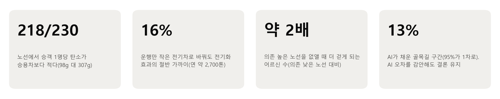

## 요약

- **지금은 대부분 친환경이다.** 230개 노선 중 218개는 승객 1명·1km당 탄소가 승용차보다 적다(중앙값 98g 대 307g).
- **하지만 조건부다.** 저녁에는 운행 4번 중 1번이 차 안 평균 인원 3명 미만으로 다니고, 버스를 한 번 더 돌리면 승용차를 타던 사람이 약 10명 옮겨 타야 본전이다.
- **연료보다 크기와 시간이다.** 차 안이 한산한 시간대(운행의 16%)만 저상 소형 전기차로 돌려도 연 약 2,700톤이 줄어, 경유·CNG 1,229대 전기화(연 약 5,700톤)의 절반 가까이 된다.
- **어르신 노선은 줄이지 말고 작게.** 어르신 의존도가 높은 노선 하나를 없애면 주변 어르신 약 1,400~1,700명이 정류장까지 더 걸어야 한다. 의존도가 낮은 노선의 약 2배다.
- **AI 오차와 가정을 바꿔도 결론은 유지된다.** AI가 채운 골목길 속도를 틀리게 잡아도, 승용차 탑승 인원이나 버스 크기를 불리하게 잡아도 190개가 넘는 노선에서 버스가 낫다.

---

## 1. 문제: 버스는 언제나 친환경일까

서울 마을버스 247개 노선에는 하루 약 93만 명이 타고, 한 번 타면 평균 1.4km를 간다. 마을버스 정류장의 18.7%는 지하철역에서 500m 밖이면서 200m 안에 일반버스 정류장도 없다. 다른 대중교통으로 바꿔 타기 어려운 동네를 잇는 교통수단이다.

그런데 손님에 비해 운행 비용이 크다. 1회 운행 원가(약 2.9만 원)와 승객 1명당 실수입(600~1,200원)으로 추정하면, 분석한 230개 노선 중 74~177개가 적자다. 적자는 운행을 줄이자는 압력으로 이어지기 쉽다.

"버스는 친환경"이라는 상식도 따져 볼 필요가 있다. 차 1대가 1km를 갈 때 마을버스는 승용차보다 CO₂를 더 낸다(서울 현재 차량 구성 기준 506g 대 369g, 부록 그림 A1). 버스의 탄소 이득은 결국 **몇 명이 타느냐**에 달려 있다.

이 보고서는 세 가지를 묻는다.

1. 노선별로 보면, 마을버스는 승객 1명당 승용차보다 탄소가 적은가?
2. 탄소를 더 줄이려면 연료(전기화), 차 크기, 운행 시간 중 무엇이 효과적인가?
3. 어르신의 이동을 지키면서 그렇게 할 수 있는가?

---

## 2. 데이터와 방법

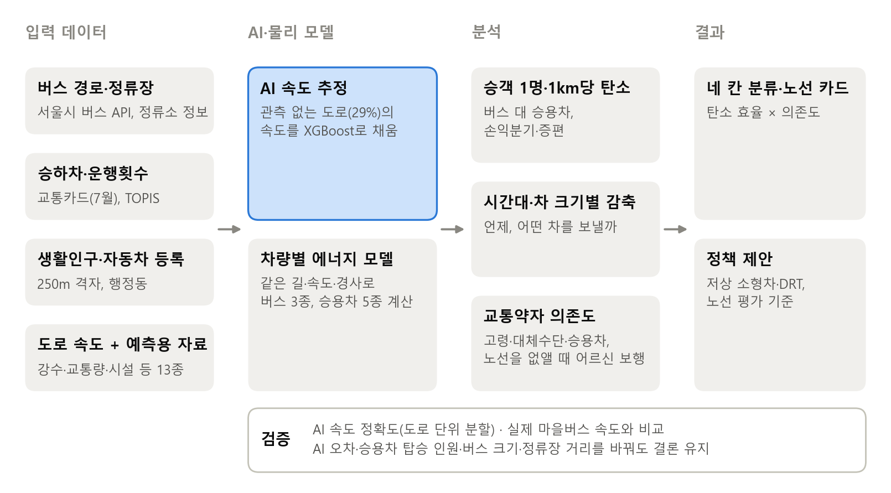

*그림 1. 분석 흐름. 관측이 없는 도로 속도는 AI가 채우고, 같은 길·속도·경사로 버스와 승용차의 탄소를 계산했다.*

**실제 노선을 도로 위에.** 247개 노선의 실제 경로(서울시 버스 API)를 20m마다 점으로 나눠, 진행 방향이 맞는 도로 구간에 붙였다(맵매칭).

**AI로 골목길 속도 채우기.**
- 서울 도로 구간의 29%는 속도 관측 기록이 없다.
- 그래서 13개 원자료(약 110GB)를 결합한 61개 피처로 XGBoost가 속도를 추정했다. 원자료에는 5분 단위 속도, 기상청 레이더 강수, 교통량, 버스전용차로·어린이보호구역·과속방지턱, 생활인구 등이 들어간다.
- 마을버스 노선 길이의 13%를 AI가 채웠다. **그 95%가 1차로 골목**이고(관측된 구간은 30%), 어르신 의존도가 높은 '② 소형 차량 전환' 칸 노선은 길이의 20%를 AI가 채웠다.
- 같은 도로가 학습과 평가에 섞이지 않도록 도로 단위로 나눠 검증했다. 결과는 평균 오차 4.6km/h, R² 0.72다. 데이터·전처리·검증의 자세한 내용은 부록 A에 있다.

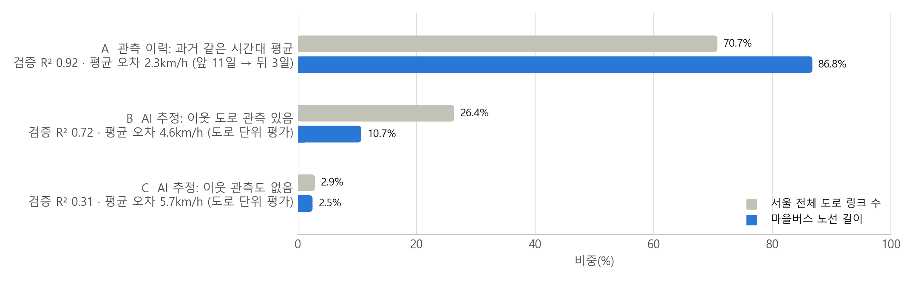

*그림 2. 속도 정보 등급별 비중과 검증 성능. 마을버스 노선 길이의 87%는 관측 속도이고, 13%를 AI가 채웠다.*

**같은 길, 같은 속도로 차량별 탄소.**
- 전기·경유·CNG 마을버스와 휘발유·경유·LPG·하이브리드·전기 승용차를 같은 노선, 같은 평일 시간대 속도, 같은 경사로 계산했다.
- 모든 모델은 공인 연비(전비)로 보정했다.
- 버스와 승용차 모두 서울의 실제 차량 구성으로 가중했고, 승용차 1대에는 1.2명이 탄다고 두었다(부록 B).

**차 안에 몇 명이 타는가.**
- 정류장 순서대로 '탄 사람 − 내린 사람'을 쌓아 구간별 인원을 구했다.
- 이를 실제 운행횟수(TOPIS)로 나눠 **차 안에 동시에 타고 있는 평균 인원(재차인원)**을 냈다.
- 승객 1명·1km당 탄소 = 버스 1km 탄소 ÷ 차 안 평균 인원이다.

**교통약자 의존도.** 세 가지를 봤다.
- 정류장 300m 안 고령 인구(평일 낮 생활인구)
- 대체수단 없는 정류장의 승차 비중(지하철역 500m 밖이면서 일반버스 정류장 200m 안 없음)
- 동네의 자가용 승용차 보유

---

## 3. 결과 ① 마을버스는 '조건부 친환경'

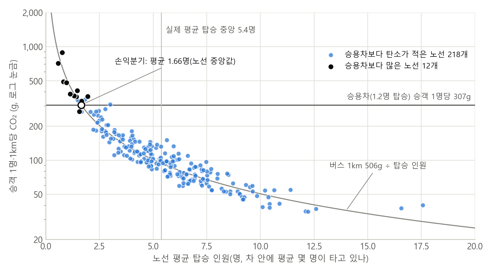

*그림 3. 노선별 차 안 평균 인원과 승객 1명·1km당 CO₂. 곡선은 '버스 1km 탄소 ÷ 차 안 인원', 가로선은 승용차 승객 1명의 탄소다. 노선마다 지나는 길의 승용차 탄소가 달라 가로선 근처 점은 노선별로 판정이 다르다.*

- 승객 1명·1km당 탄소는 마을버스 98g, 승용차 307g이다(중앙값). **마을버스가 약 1/3이다.** 230개 중 218개 노선이 승용차보다 적다.
- 차 안에 평균 1.66명만 있어도 승용차와 같아지는데, 실제 차 안 평균 인원은 5.4명이다. 승용차보다 많은 12개 노선은 모두 2명 미만이다.

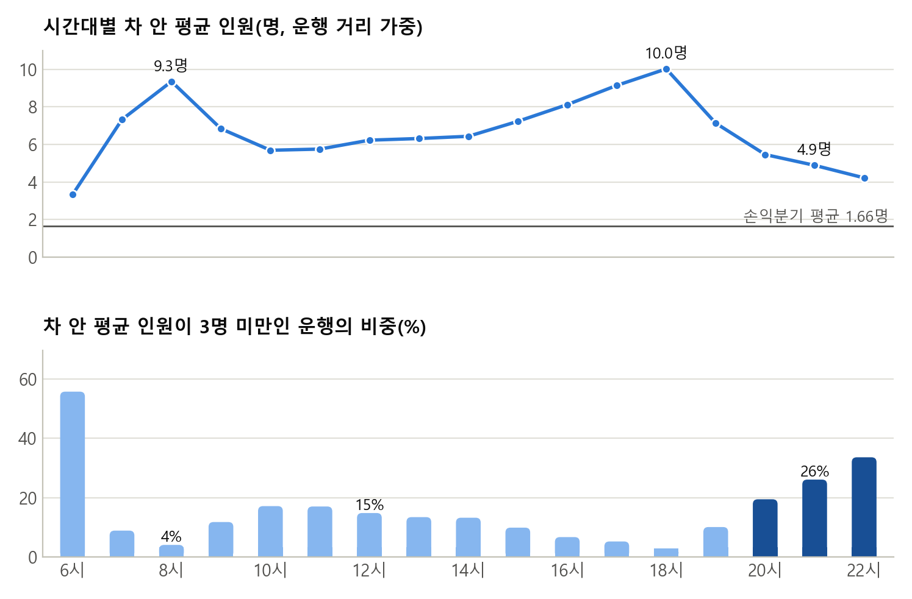

*그림 4. 시간대별 차 안 평균 인원(위)과 차 안 평균 인원이 3명 미만인 운행의 비중(아래).*

- 출퇴근 정점(8시, 18시)에는 차 안에 평균 9~10명이 있다.
- 저녁 20~22시에는 4.9명으로 줄고, 운행 4번 중 1번(26%)은 차 안 평균 인원이 3명 미만이다. 이른 아침(6시)은 절반 이상이 그렇다.
- 이런 운행도 1회에 13명 안팎(중앙 13.7명)이 타고 내린다. 다만 한 사람이 평균 1.4km만 타서, 한꺼번에 차 안에 있는 사람이 적다.
- 즉 **손님이 없는 것이 아니라, 큰 차가 필요 없는 것**이다.

**증편은 승용차에서 10명이 넘어와야 본전이다.**
- 버스를 한 번 더 돌리면 그만큼 탄소가 늘어난다. 이를 메우려면 그 1회 운행에 승용차를 타던 사람이 약 10명 옮겨 타야 한다(노선 가운데 절반이 7.7~12.7명).
- 그래서 **"버스를 늘리면 친환경"은 승용차 이용자를 실제로 끌어올 때만 성립한다.**
- 참고로, 지금 승객이 모두 승용차를 탔다면 하루 최대 325톤(연 약 11.9만 톤)을 더 냈을 것이다. 다만 이는 모든 승객이 승용차를 대신 탄다고 가정한 **상한**이다.

---

## 4. 결과 ② 연료보다 크기, 그리고 시간

*그림 5. 마을버스 탄소를 줄이는 세 가지 방법의 감축량(지금 차량 구성 대비, 각 방법을 따로 했을 때). '크기 효과'는 같은 전기차끼리 비교한 몫이다.*

- **전기화**: 경유·CNG 마을버스 1,229대를 모두 전기버스로 바꾸면 하루 15.5톤(연 약 5,700톤, 마을버스 배출의 14%)이 줄어든다.
- **차 크기**: 15인승급 소형 전기 승합차는 1km당 242g으로, 전기 마을버스(437g)보다 약 45% 적다. 같은 에너지 모델, 같은 정지·출발 기준으로 계산했다.
- **운행 시간**: 차 안 평균 인원이 3명 미만인 시간대만 지금 버스 대신 소형 전기차로 돌리면 하루 7.5톤(연 약 2,700톤)이 줄어든다.
  - **전체 운행의 16%만 바꿔서 전기화 효과의 절반 가까이(48%)를 얻는다.**
  - 이 중 5.6톤은 차를 작게 한 효과다.
- '3명 미만'은 15인승의 5분의 1에도 못 미치고 손익분기(1.66명)에 가까운 운행이다. 기준을 2명·4명 미만으로 바꾸면 운행 6%·27%, 하루 2.8톤·13.1톤이다.
- 결론적으로 **어떤 연료로 달리느냐만큼, 몇 명을 태울 차를 언제 보내느냐가 중요하다.**

---

## 5. 결과 ③ 어르신 노선은 줄이지 말고 작게

### 5.1 탄소 효율 × 교통약자 의존도, 네 칸

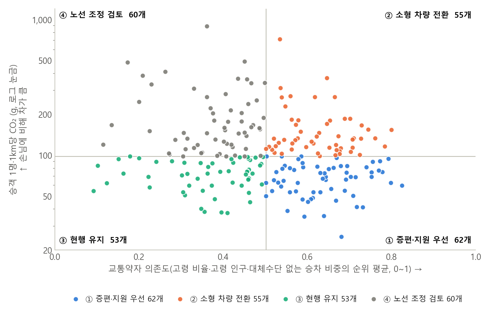

*그림 6. 노선별 교통약자 의존도와 승객 1명·1km당 CO₂. 가로·세로 선은 230개 노선의 중앙값이다.*

**나누는 기준**
- 교통약자 의존도: 고령 비율, 고령 인구, 대체수단 없는 승차 비중을 노선끼리 순위로 바꿔 평균했다.
- 탄소 효율: 승객 1명·1km당 CO₂가 노선 중앙값(약 98g)보다 낮은지 높은지
- 군집 분석(K-평균, HDBSCAN)으로는 뚜렷한 노선 유형이 나오지 않아, 해석하기 쉬운 중앙값 기준으로 나눴다.

| 칸 | 노선 수 | 하루 승차(중앙) | 차 안 평균 인원 | 승객 1명·1km당 CO₂ | 고령 비율 | 승용차(1,000명당) | 적자 노선 비율* |
| --- | --- | --- | --- | --- | --- | --- | --- |
| ① 증편·지원 우선 | 62 | 5,478명 | 7.3명 | 68g | 25% | 254대 | 21% |
| ② 소형 차량 전환 | 55 | 2,569명 | 4.2명 | 131g | 27% | 231대 | 73% |
| ③ 현행 유지 | 53 | 4,772명 | 6.6명 | 73g | 17% | 273대 | 32% |
| ④ 노선 조정 검토 | 60 | 1,914명 | 3.5명 | 154g | 21% | 267대 | 87% |

*승객 1명당 실수입 900원 기준. 600원이면 ② 칸 93%, 1,200원이면 49%가 적자다.

- **② 칸은 어르신이 가장 많고 승용차는 가장 적다.**
  - 어르신이 많은 노선일수록 동네에 승용차가 적다(순위상관 −0.42, 부록 그림 A2).
  - 언덕(평균 경사 3.1%, 경사 때문에 에너지 +37%)과 골목(1차로 54%)이 가장 많은 칸이다.
  - 동작·은평·강북·서대문·성북처럼 언덕이 많은 자치구에 모여 있다(부록 그림 A3).
- 그런데 손님이 적어 탄소 효율이 낮고, 적자 노선 비율이 73%다. 운행을 줄이자는 압력을 크게 받는 칸이다.

### 5.2 노선을 줄이면 누가 얼마나 더 걷나

노선 하나를 없애면 그 노선만 서는 정류장이 사라진다. 그때 주변 어르신(평일 낮 고령 생활인구)이 가장 가까운 버스 정류장까지 걷는 시간이 얼마나 늘어나는지를 노선마다 계산했다.
- 걷는 속도는 노인 걸음(Tobler 보행속도 × 0.75)이고, 오르막·내리막을 걷는 방향대로 반영했다.
- 도로망 기준과 직선 간이 기준, 두 방식으로 범위를 냈다.

| 칸 | 영향받는 어르신(노선 중앙값) | 평균 증가 시간 | 10분 넘게 걷게 되는 어르신이 100명 이상인 노선 |
| --- | --- | --- | --- |
| ① 증편·지원 우선 | 1,490~1,740명 | 2.8~3.4분 | 24~42% |
| ② 소형 차량 전환 | 1,240~1,500명 | 2.9~3.6분 | 13~27% |
| ③ 현행 유지 | 600~740명 | 2.2~2.8분 | 17~19% |
| ④ 노선 조정 검토 | 730~890명 | 2.4~3.1분 | 8~28% |

*범위의 앞은 직선 간이 기준, 뒤는 도로망 기준. '영향받는 어르신'은 보행 시간이 1분 이상 늘어나는 고령 인구다.*

- **의존도가 높은 칸(①②)의 노선을 없애면, 낮은 칸(③④)보다 약 2배 많은 어르신이 더 걸어야 한다.** 의존도 지표가 실제 피해의 크기와 맞는다.
- **② 칸은 적자 노선 비율이 ① 칸(21%)보다 훨씬 높지만, 없앴을 때의 피해는 ① 칸에 가깝다.** 수입만 보면 줄이기 쉬운 노선이, 실제로는 줄이면 피해가 큰 노선이다.
- 이 값은 가장 가까운 '아무 버스 정류장'까지의 시간이다. 그 버스가 같은 곳으로 가지 않으면 실제 불편은 더 크다.

### 5.3 노선 사례

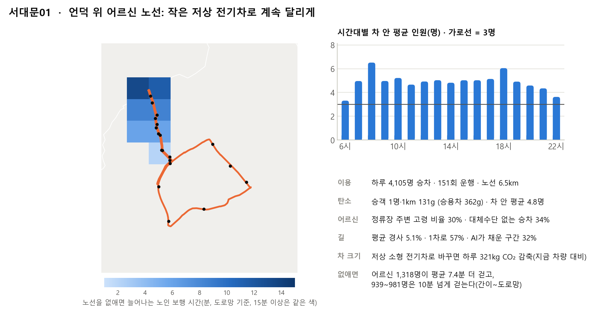

*그림 7. 서대문01. 차 안 평균 인원이 하루 내내 3~7명이라 15인승급 저상 소형 전기차로 충분하다. 노선을 없애면 어르신 약 1,300명이 평균 7.4분 더 걷고, 약 950명은 10분 넘게 걸어야 한다.*

- 같은 ② 칸이라도 처방은 다르다. 관악04는 하루 6,700명이 타고 가장 붐비는 구간이 1회 평균 17명이라 작은 차로는 부족하다(부록 그림 A4). 이런 노선은 지금 크기 그대로 전기화와 운행 지원을 우선한다.
- 노선별 숫자가 있어야 이런 구분이 가능하다.

---

## 6. 정책 제안

| 제안 | 무엇을 | 대상 | 기대 효과 |
| --- | --- | --- | --- |
| **1. 노선 평가에 탄소와 어르신 의존도를 넣는다** | 적자 노선을 네 칸으로 나눠 다르게 다룬다. ②는 지키되 작게, ④는 조정 검토 | 마을버스 전체 | 의존도 높은 노선 하나를 없애면 어르신 약 1,400~1,700명이 더 걷는다. 이런 결정을 막는다 |
| **2. 차 크기와 운행 시간을 손님에 맞춘다** | ② 칸 노선은 저상 소형 전기차로 바꾸고, 차 안이 한산한 시간대는 호출형 소형 전기차(수요응답형 교통, DRT)로 대신한다 | ② 칸 29개 노선 / 차 안 평균 3명 미만 시간대(운행의 16%) | 연 약 1,600톤 / 연 약 2,700톤 감축(각각, 지금 차량 대비) |
| **3. 증편은 조건부로 한다** | 손님이 많은 칸(①③) 중 승용차가 많은 동네부터 시범 증편하고, 탑승이 실제로 늘었는지 확인한 뒤 넓힌다 | 30개 노선 | 증편 1회는 승용차 이용자 약 10명이 옮겨 타야 본전이다 |

- **전기화는 함께 간다.** 경유·CNG 1,229대를 전기버스로 바꾸면 연 약 5,700톤이 줄어든다. 차를 작게 하면 같은 전기로도 덜 쓴다.
- **소형차는 저상이거나 휠체어로 탈 수 있어야 한다.** 2023년 1월부터 마을버스도 차량을 바꿀 때 원칙적으로 저상버스로 도입해야 한다. 계단이 높은 일반 승합차는 어르신에게 오히려 불편하다.
- **DRT는 이미 있는 정책 수단이다.** 운수사가 노선마다 큰 차·작은 차를 다 갖추라는 뜻이 아니다.
  - 국토교통부는 2025년 12월 DRT 도입·운영 가이드라인을 냈고, 서울에서도 은평구 '셔클'(2020~2022) 시범이 있었다.
  - 여러 노선을 한 권역으로 묶으면 차량과 차고지 부담을 나눌 수 있다.
- 감축량은 각 제안을 따로 했을 때의 값이라 그대로 더하면 안 된다.

---

## 7. 결과는 얼마나 믿을 만한가, 그리고 한계

| 점검 | 방법 | 결과 |
| --- | --- | --- |
| AI 속도 정확도 | 도로 단위로 나눠 평가(B·C), 앞 11일로 만들고 뒤 3일로 평가(A) | B: 평균 오차 4.6km/h(R² 0.72), C: 5.7km/h(0.31), A: 2.3km/h(0.92) |
| 실제 버스 속도와 비교 | 서울 마을버스 시간대별 실측 속도(부록 그림 A5) | 낮 시간 차이 1km/h 안팎, 저녁 20~22시는 분석 속도가 약 2.5km/h 빠름 |
| AI 오차가 결론을 바꾸나 | AI가 채운 구간 속도를 모두 5km/h(B 평균 오차보다 조금 큼) 낮게·높게 잡아 다시 계산(버스·승용차 모두) | 세 경우 모두 버스가 나은 노선 217/230, 같은 칸 208/230(90%) |
| 승용차 탑승 인원 | 1.2명 → 1.35명(출근 평균) → 1.82명(하루 평균, 2010) | 버스가 나은 노선 218 → 215 → 206/230. 손익분기 1.66 → 1.86 → 2.51명(실제 5.4명) |
| 버스 크기·승용차 연비 | 버스 배출 1.28배(대형 76% 반영 추정)·1.5배, 승용차 배출 0.8배, 가장 불리한 조합 | 버스가 나은 노선 212·206 / 212 / 192/230 |
| 대체수단 판정 거리 | 일반버스 정류장 200m → 150m·300m, 직선 → 실제 도로망 거리 | 같은 칸 212·208/230, 201/230(87%) |

- 어떤 가정을 바꿔도 "대부분 노선에서 버스가 낫다"는 결론과 네 칸 분류는 크게 바뀌지 않았다.
- 판정이 바뀌는 노선은 대부분 원래 기준선 근처에 있던 노선이다. 대체수단 거리를 도로망 기준으로 바꿨을 때 칸이 바뀐 29개 중 76%는 기준선에서 백분위 10%p 안쪽에 있었다(전체 노선은 37%).

**한계**
- **차량 정보**: 노선별 차량 정보가 없어 서울 전체 연료 구성을 모든 노선에 적용하고, 차량은 중형(카운티)으로 두었다. 실제 서울 마을버스는 대형이 76%다(위 표에서 버스 배출 1.5배까지 확인).
- **에너지 모델**: 공인값으로 보정했지만, 실제 충전량·연료 소비와 따로 비교하지는 못했다. 실제 운행 전력과 승객 수가 기록된 공개 자료(예: 취리히 전기버스 ZTBus)와 국내 운수사 충전 기록으로 점검하는 것이 다음 과제다.
- **AI 속도**: 관측 도로를 가려서 검증했으므로, 실제로 관측이 없는 골목과 성격이 다를 수 있다.
- **노선 제거 영향**: 가장 가까운 정류장까지의 보행만 셌다. 목적지가 다른 버스를 타야 하는 불편은 빠져 있어 실제보다 작게 잡힌 값이다.
- **시간대·비용**: 시간대별 인원은 승객·km가 승차와 같은 시간 분포를 따른다고 근사했다. 적자와 소형차·DRT 도입 비용은 정밀하게 따지지 않았다.

---

## 8. 결론

마을버스는 지금 대부분의 노선에서 승용차보다 승객 1명당 탄소가 적다. 하지만 그 이득은 손님이 탈 때만 생긴다. 저녁처럼 차 안이 한산한 시간과, 승용차 이용자를 끌어오지 못하는 증편에서는 이득이 사라진다.

탄소를 더 줄이는 길은 연료만이 아니다. 손님 수에 맞는 크기의 차를 손님이 있는 시간에 보내면, 운행의 16%만 바꿔도 전기화 효과의 절반 가까이를 얻는다. 어르신이 많고 승용차가 적은 언덕 동네의 노선은 적자 때문에 줄일 대상이 아니다. 서대문01처럼 작은 저상 전기차로 계속 달리게 할 대상이다.

이 판단은 13개 원자료를 결합한 AI가 관측이 없는 골목길 속도까지 채워 준 덕분에, 230개 노선 하나하나에 같은 기준으로 내릴 수 있었다. AI 오차와 주요 가정을 바꿔도 결론은 유지됐다. 서울시와 자치구는 마을버스 지원 기준을 정할 때 이 방식으로 탄소와 이동권을 함께 따질 수 있다.

---

## 부록

### A. AI 속도 모델: 데이터, 전처리, 검증

**학습 데이터.** 2026년 7월 7~20일 실제 관측 속도(링크 44,960개, 1,505만 행)를 학습 목표로 두었다. 13개 원자료(약 110GB)를 도로 구간 단위로 결합했고, 결과를 정적 속성 표와 시간별 관측 표 두 개(약 1.1GB)로 정리했다.

| 피처 묶음 | 개수 | 원자료 |
| --- | ---: | --- |
| 도로 속성·지형·시간·강수 | 22 | 국가표준노드링크, 수치표고모델(DEM), 기상청 레이더 강수 |
| 도로망 구조(교차로 연결, 주변 도로 제한속도·차로 등) | 18 | 국가표준노드링크 |
| 같은 도로명 구간 길이, 도심까지 거리 | 5 | 국가표준노드링크 |
| 시간대별 혼잡강도·평균속도 | 5 | 한국교통연구원 View-T |
| 버스전용차로, 어린이보호구역, 과속방지턱, 사고다발지역, 교통량 | 7 | 서울 열린데이터광장, 한국도로교통공단, 한국교통연구원, 교육데이터플랫폼 |
| 생활인구 | 2 | 서울 생활인구 |
| 이웃 도로 속도, 교차로 유형 | 2 | 국가교통정보센터 관측 속도, 국가표준노드링크 |

**전처리.**
- **속도**: 5분 단위 속도(93GB)를 도로 구간·시간 단위로 평균했다. 한 시간 12번 중 실제로 잡힌 횟수는 학습 가중치로 썼다.
- **강수**: 기상청 레이더 강수(16GB)를 도로 구간·시간마다 붙였다.
- **교통량·View-T**: 약 61%가 비어 있다. 조사되지 않았다는 뜻이라 0으로 채우지 않았다.
- **시설**: 버스전용차로 같은 시설은 없으면 0이 맞으므로 0으로 채웠다.
- **경사**: 짧은 도로의 비현실적인 값을 막기 위해 에너지 계산에서는 ±12%로 제한했다.

**세 등급.**
- **A**: 관측 이력이 있는 도로. 과거 같은 시간대 평균을 쓴다.
- **B**: 관측은 없지만 1~2칸 이웃 도로가 관측되는 경우. 이웃 속도를 넣은 XGBoost로 추정한다.
- **C**: 이웃 관측도 없는 경우. 이웃 속도를 뺀 XGBoost로 추정한다.
- SHAP으로 본 가장 큰 단서는 이웃 도로 속도(기여도 35.6%)였다. 주변이 막히면 이 도로도 막힌다.

**검증.**
- B·C는 도로 단위로 3번 나눠 평가했고, 이웃 속도도 학습용 도로에서만 만들었다.
  - B: R² 0.72, 평균 오차 4.6km/h(오차의 90%가 ±10km/h 안)
  - C: R² 0.31, 평균 오차 5.7km/h
- A는 앞 11일로 만들고 뒤 3일로 평가했다. R² 0.92, 평균 오차 2.3km/h다.
- C 모델은 약하지만 마을버스 노선 길이의 2.5%에만 쓰인다.

**모델 개발 과정**

| 단계 | 사용한 정보 | 평가 방식 | R² |
| --- | --- | --- | ---: |
| 전체 평균 | 없음 | 무작위 분할 | 0.00 |
| 제한속도 선형회귀 | 제한속도 | 무작위 분할 | 0.17 |
| 도로등급별 평균 | 도로 등급 | 무작위 분할 | 0.27 |
| XGBoost(기본) | 도로 속성 23개 | 무작위 분할 | 0.63 |
| XGBoost(최종 피처) | 약 60개 정제 피처(같은 시각 이웃 관측 사용, 실험값) | 도로 단위 분할 | 0.74 |
| 실제 적용(B·C) | 61개 피처(이웃 속도는 과거 같은 시간대 평균) | 도로 단위 분할 | 0.72 |

- 무작위 분할은 같은 도로가 학습과 평가에 섞여 점수가 후하게 나오는 방식이다. 그런데도 더 엄격한 도로 단위 분할에서 최종 모델이 더 높았다. 성능을 끌어올린 것은 알고리즘보다 여러 데이터를 결합한 피처였다.
- 같은 피처에서 LightGBM(0.737)보다 나은 XGBoost(0.740)를 택했다.
- 실제 적용에서는 미래 시점에 쓸 수 없는 '같은 시각 이웃 관측' 대신 '과거 같은 시간대 이웃 평균'을 넣었다. 그래서 공식 성능은 0.72로 본다.

### B. 차량별 에너지 모델과 기준값

| 차량 | 계산 방법 | 보정 기준 |
| --- | --- | --- |
| 전기 마을버스 | 물리 기반 전기차 에너지 모델(VT-CPEM) | 현대 카운티 일렉트릭(배터리 128kWh, 복합 303km), 차량 7t, 냉방 5kW |
| 경유·CNG 마을버스 | 같은 길에서 전기버스가 쓰는 전력 × 서울 실측 연료 비율 | 서울 같은 노선 실측: 전기 1.43kWh/km 대비 경유 723g, CNG 721g/km(전기전자학회논문지 24(3), 2020) |
| 휘발유·경유·LPG 승용차 | 연료 소모 모델(VT-CPFM 계열) | 쏘나타 2.0, 쏘렌토 2.2 디젤, 쏘나타 LPi |
| 하이브리드 승용차 | 하이브리드 연료 모델(Ahn & Rakha, 2019) | 쏘나타 하이브리드 |
| 전기 승용차 | VT-CPEM | 아이오닉5 |
| 소형 전기 승합차 | VT-CPEM | 15인승급, 3.5t, 냉방 3kW, 정지·출발 부가 전력은 마을버스와 같은 기준(질량 비례) |

- 마을버스는 서울 연료 구성(CNG 885대, 경유 344대, 전기 397대, 2026.1)으로 가중했다.
- 승용차는 서울 등록 구성(휘발유 57%, 경유 20%, 하이브리드 13%, LPG 6%, 전기·수소 4%, 2026.7)으로 가중했다.

| 기준값 | 값 | 근거 |
| --- | --- | --- |
| 승용차 탑승 인원 | 1.2명(민감도 1.35·1.82명) | 국가교통조사 '나 홀로' 승용차 82.5%(전국, 국토교통부·한국교통연구원 2018년 발표). 가구통행실태조사 평균 재차인원은 출근 1.35명, 하루 1.82명(2010, 국토교통부) |
| 역세권 | 500m | 서울특별시 「역세권 장기전세주택 건립 운영기준」(승강장 경계 500m), 「도시재정비 촉진을 위한 특별법 시행령」(역 반경 500m) |
| 일반버스 정류장 접근 | 200m(민감도 150·300m) | 공식 기준 없음. 노인 보행속도(초속 약 1m) 기준 약 3분 |
| 전력 배출계수 | 0.4173kgCO₂/kWh | 국가 전력배출계수(2023년도, 2025.12 공표) |
| 저상버스 도입 의무 | 마을버스 포함 | 2023년 1월 19일부터 노선버스 대·폐차 시 원칙적으로 저상버스 도입(교통약자의 이동편의 증진법 개정) |
| 수요응답형 교통(DRT) | — | 국토교통부 「수요응답형교통 도입·운영 가이드라인」(2025.12), 서울 은평구 '셔클' 시범(2020.2~2022.4) |
| 1회 운행 원가 | 약 2.9만 원 | 2026년 마을버스 재정지원 기준액(1대 하루 510,457원) ÷ 1대 하루 운행 17.8회(2026.1 서울 마을버스 현황) |
| 연 단위 환산 | 하루 평균 × 365 | 승하차·운행횟수는 7월 하루 평균(주말 포함) |

### C. 추가 결과

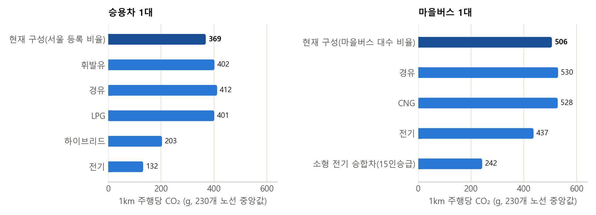

*그림 A1. 차 1대가 1km를 갈 때의 CO₂(230개 노선 중앙값). 마을버스는 현재 구성 506g으로 승용차(369g)보다 많다.*

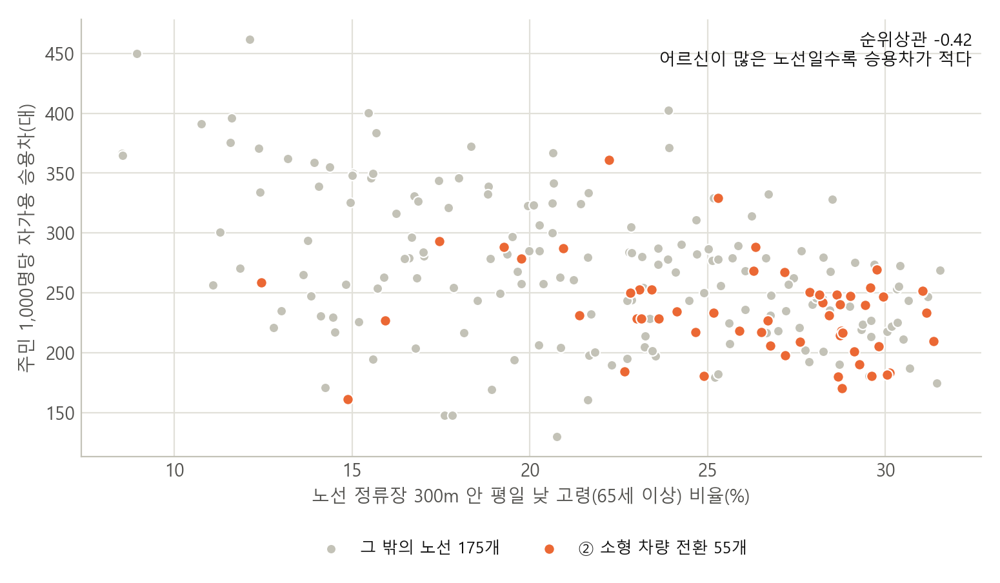

*그림 A2. 노선 주변 고령 비율과 주민 1,000명당 자가용 승용차(130~462대, 중앙 약 250대). 순위상관 −0.42. 주황색은 '소형 차량 전환' 칸 노선이다.*

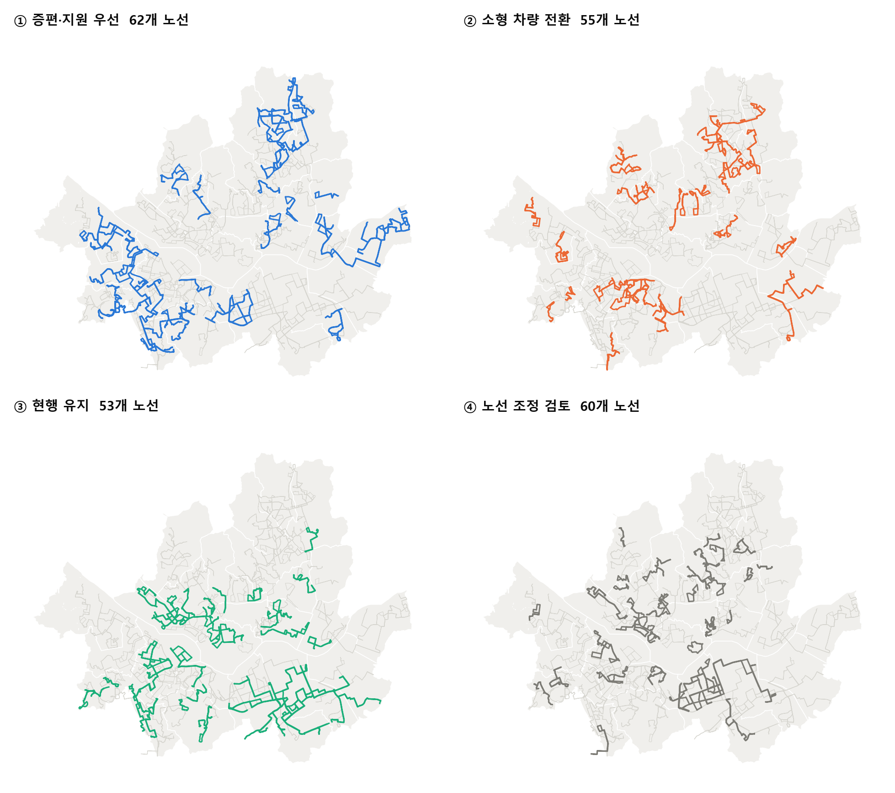

*그림 A3. 네 칸 노선의 위치. 회색 선은 다른 칸 노선이다.*

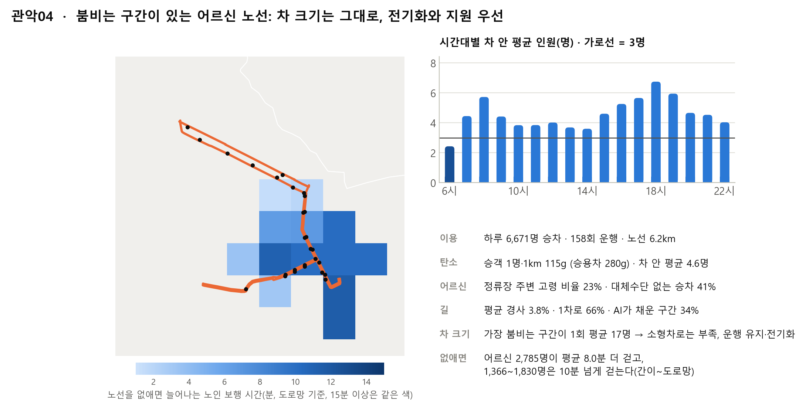

*그림 A4. 관악04. 하루 6,700명이 타고, 승차의 41%가 대체수단 없는 정류장에서 나온다. 가장 붐비는 구간이 1회 평균 17명이라 소형차로는 부족하다. 노선을 없애면 어르신 약 2,800명이 평균 8분 더 걷고, 1,400~1,800명은 10분 넘게 걸어야 한다.*

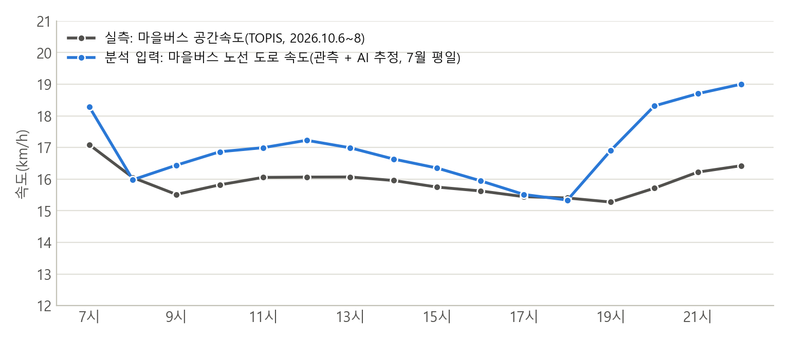

*그림 A5. 실제 마을버스 시간대별 속도(TOPIS 노선유형 통계, 2026.10.6~8)와 분석에 쓴 마을버스 노선 도로 속도(관측 + AI 추정, 7월 평일). 노선별 버스 속도 자료가 없어 마을버스 전체 평균끼리 비교했다.*

| 칸 | 평균 경사 | 경사로 늘어나는 에너지 | 1차로 도로 비중 | 낮 평균 속도 | AI가 채운 구간 |
| --- | --- | --- | --- | --- | --- |
| ① 증편·지원 우선 | 2.1% | +25% | 37% | 17.2km/h | 10% |
| ② 소형 차량 전환 | 3.1% | +37% | 54% | 16.4km/h | 20% |
| ③ 현행 유지 | 2.0% | +21% | 31% | 17.5km/h | 8% |
| ④ 노선 조정 검토 | 3.1% | +33% | 40% | 16.2km/h | 11% |

*노선별 값의 칸 중앙값. '경사로 늘어나는 에너지'는 같은 노선을 평지로 가정했을 때보다 전기 마을버스 에너지가 얼마나 더 드는지다.*

### D. 데이터 출처

| 데이터 | 출처 | 쓰임 |
| --- | --- | --- |
| 노선별 정류소와 순서 | 서울 열린데이터광장(OA-1095) | 노선 구성 |
| 노선 실제 경로 좌표 | 서울시 버스운행정보 API | 도로 위에 노선 올리기 |
| 정류장별·시간대별 승하차(2026.7) | 서울 열린데이터광장(OA-12913) | 승객 수 |
| 노선·정류장별 운행횟수(2026.7) | 서울 열린데이터광장(OA-21220, TOPIS) | 실제 운행횟수 |
| 도로 속도와 속도 예측용 자료 13종 | 국가교통정보센터, 기상청 등(부록 A) | AI 속도 모델 |
| 250m 격자·행정동 생활인구(2026.7) | 서울 생활인구 | 고령 인구, 주민 수 |
| 연료별 자동차 등록(2026.7, 서울·행정동) | 서울 열린데이터광장 | 승용차 구성, 동네별 승용차 보유 |
| 지하철역 위치 | 서울 열린데이터광장(OA-21232) | 대체수단 |
| 마을버스 연료별 대수(2026.1) | 서울시 마을버스 현황 | 버스 구성 |
| 노선유형별 버스 속도(2026.10) | 서울 버스 통행속도 통계 | 속도 입력 점검 |

기간: 도로 속도는 2026년 7월 평일(7~20일) 시간대별 평균, 승하차와 운행횟수는 7월 한 달(주말 포함)의 하루 평균이다.

### E. 재현 방법

- 코드: https://github.com/ejjunm/seoul-eco-routing/tree/feature/maeul-bus-carbon
  - 속도 모델: `src/pipeline/`, `src/models/`
  - 마을버스 분석: `src/transit/`
- 실행 순서: `src/transit/01_build_bus_route_links.py` → `02` → … → `11_route_removal_access.py`. 그림은 `src/transit/report_figures.py`로 만든다.
- 데이터는 저장소에 포함하지 않으며, 출처는 부록 D와 같다.

### F. 용어

- **차 안 평균 인원(재차인원)**: 차 안에 동시에 타고 있는 평균 인원. 한 번 운행에 타는 사람 수와 다르다.
- **승객·km**: 승객 수 × 탄 거리. 승객 10명이 1km씩 타면 10승객·km다.
- **손익분기**: 버스가 승객 1명당 탄소에서 승용차와 같아지는 차 안 평균 인원.
- **증편 손익분기**: 늘린 1회 운행이 탄소 손해를 보지 않으려면 승용차에서 옮겨 타야 하는 사람 수.
- **맵매칭**: GPS 경로 좌표를 실제 도로 구간에 붙이는 작업.
- **R²(결정계수)**: 예측이 실제 값의 변화를 얼마나 설명하는지(1에 가까울수록 좋음).
- **SHAP**: 각 피처가 예측에 얼마나, 어느 방향으로 기여했는지 나누어 보여 주는 방법.
- **순위상관**: 두 값의 순서가 얼마나 같이 움직이는지(−1~1). 음수면 한쪽이 클수록 다른 쪽이 작다.
